<div align="center">

# Experiment 3 — Building a Three-Node Kubernetes Cluster on Windows
### kind (Kubernetes IN Docker) · 1 Control Plane + 2 Workers · NGINX Deployment, Scaling and Self-Healing

**Course:** Cloud Computing Laboratory
**Tools:** Docker Desktop 4.97.0 (WSL 2) · kind v0.33.0 · kubectl v1.36.1 · Kubernetes v1.37.0 · NGINX
**Platform:** Windows PC · PowerShell · each Kubernetes node runs as a Docker container


</div>

---

## Abstract

**Kubernetes** is the standard platform for running containers on many machines at once. You tell it the *desired state* (for example, "run 6 copies of NGINX"), and it keeps the real state matching that, even when something breaks.

In this experiment, a complete **three-node Kubernetes cluster** was built on a Windows PC with **kind**, which runs each Kubernetes node as a Docker container. The cluster had one **control-plane** node and two **worker** nodes. An **NGINX** web server was then deployed, scaled and deliberately broken:

- **Cluster:** all **3 nodes** reached `Ready` on Kubernetes **v1.37.0**, and all **12 system Pods** (API server, etcd, scheduler, controller manager, CoreDNS, kube-proxy, kindnet) were `Running`.
- **Deployment:** 3 NGINX Pods were placed **1 on `kind-worker` and 2 on `kind-worker2`**. None ran on the control plane. The first Pod took **97 s** to start, and **96.4 s** of that was downloading the 63.9 MB `nginx` image.
- **Scaling:** `kubectl scale --replicas=6` produced **3 + 3** Pods across the two workers. The new Pods were `Running` within **10 s**, because the image was already on both nodes.
- **Self-healing:** a Pod was deleted on purpose. Kubernetes created a **replacement automatically**, and **6/6 Pods** were `Running` again when the replacement was **14 s** old.

---

## Table of Contents

1. [Introduction](#1-introduction)
2. [Aim and Objectives](#2-aim-and-objectives)
3. [Basic Concepts](#3-basic-concepts)
4. [Experimental Setup](#4-experimental-setup)
5. [Methodology and Workflow](#5-methodology-and-workflow)
6. [Part A — Tools and Checks (Manual Parts 1–2)](#6-part-a--tools-and-checks-manual-parts-12)
7. [Part B — Cluster Configuration File (Manual Part 3)](#7-part-b--cluster-configuration-file-manual-part-3)
8. [Part C — Building the Three-Node Cluster (Manual Part 4)](#8-part-c--building-the-three-node-cluster-manual-part-4)
9. [Part D — Deploying NGINX (Manual Part 5)](#9-part-d--deploying-nginx-manual-part-5)
10. [Part E — Scaling and Self-Healing (Manual Part 6)](#10-part-e--scaling-and-self-healing-manual-part-6)
11. [Consolidated Results](#11-consolidated-results)
12. [Analysis](#12-analysis)
13. [Docker Compose vs Kubernetes — Comparison](#13-docker-compose-vs-kubernetes--comparison)
14. [Observations and Limitations](#14-observations-and-limitations)
15. [Troubleshooting and Issues Encountered](#15-troubleshooting-and-issues-encountered)
16. [Important Terms](#16-important-terms)
17. [Conclusion](#17-conclusion)
18. [Repository Structure and Reproduction](#18-repository-structure-and-reproduction)
19. [References](#19-references)

---

## 1. Introduction

Docker can start a container on **one** machine. A real cloud application, however, runs **many copies** of many containers on **many machines**. Someone has to decide which machine runs which container, restart containers that crash, and add more copies when needed. Doing this by hand does not scale.

**Kubernetes** (often written **K8s**) automates this job. It is a **container orchestrator**:

| Without Kubernetes | With Kubernetes |
|:--|:--|
| You start each container yourself, on a machine you choose | You describe what you want; the **scheduler** picks the machine |
| A crashed or deleted container stays gone | The **controller** notices and creates a new one (**self-healing**) |
| Adding copies means running more commands on more machines | One command: `kubectl scale ... --replicas=6` |
| Each machine is managed separately | All machines act as one **cluster** |

A real cluster needs several computers. **kind** (Kubernetes IN Docker) makes it possible to build a multi-node cluster on a single laptop: each "node" is a Docker container that runs the full Kubernetes node software inside it. This gives the same behaviour as a real cluster (scheduling, networking, self-healing) without extra hardware.

---

## 2. Aim and Objectives

**Aim:** To build a local Kubernetes cluster with one control-plane node and two worker nodes on Windows, deploy an NGINX web application, and test scaling and self-healing.

**Objectives** (from the lab manual):

| # | Objective | Manual part |
|:-:|:--|:-:|
| 1 | Install and verify WSL 2, Docker Desktop, kubectl and kind | 1–2 |
| 2 | Write a kind configuration file that describes a three-node cluster | 3 |
| 3 | Create the cluster and check that all nodes and system Pods are healthy | 4 |
| 4 | Deploy three NGINX Pods and find out which node each one runs on | 5 |
| 5 | Scale the Deployment to six Pods, delete one, and watch Kubernetes replace it | 6 |

---

## 3. Basic Concepts

### 3.1 Kubernetes building blocks

| Term | Meaning | In this experiment |
|:--|:--|:--|
| **Cluster** | A group of machines (nodes) managed as one system | The kind cluster named `kind` |
| **Node** | One machine in the cluster | `kind-control-plane`, `kind-worker`, `kind-worker2` (Docker containers) |
| **Control plane** | The "brain": stores the cluster state and makes decisions | `kind-control-plane` |
| **Worker node** | The "muscle": runs the application containers | `kind-worker`, `kind-worker2` |
| **Pod** | The smallest unit Kubernetes runs: one or more containers sharing an IP | `web-5fc9f4bf66-6bm4p`, … |
| **Deployment** | Describes *what* to run and *how many* copies | `web`, image `nginx` |
| **ReplicaSet** | Created by the Deployment; keeps the right number of Pods alive | `web-5fc9f4bf66` (seen in `describe pod`) |
| **kubectl** | The command-line tool used to talk to the cluster | v1.36.1 |
| **Context** | Which cluster kubectl is talking to | `kind-kind` |

### 3.2 Control-plane components (all seen running in Step 4.5)

| Component | Job |
|:--|:--|
| **kube-apiserver** | The front door. Every `kubectl` command is an API call to it |
| **etcd** | The database that stores the whole cluster state (desired and actual) |
| **kube-scheduler** | Chooses a node for every new Pod |
| **kube-controller-manager** | Runs the control loops, including the ReplicaSet controller that replaces missing Pods |
| **CoreDNS** | Gives services and Pods DNS names inside the cluster |
| **kube-proxy** (every node) | Sets up the network rules for Services |
| **kindnet** (every node) | kind's network plugin (CNI); gives each Pod an IP address |

### 3.3 Desired state and the control loop

Kubernetes is built on one idea, repeated everywhere:

```text
            +-------------------------------+
            |  DESIRED state (in etcd)      |   e.g. replicas = 6
            +---------------+---------------+
                            | compare
            +---------------v---------------+
            |  ACTUAL state (Pods running)  |   e.g. 5 Pods (one was deleted)
            +---------------+---------------+
                            | difference?  -> act (create 1 Pod)
                            +--------------> repeat forever
```

`kubectl scale` changes the **desired** number, and the controller adds Pods. `kubectl delete pod` changes the **actual** number, and the controller adds a Pod back. Both experiments in Part 6 are the same control loop seen from two sides.

---

## 4. Experimental Setup

### 4.1 Environment (from the screenshots)

| Item | Value |
|:--|:--|
| Host | Windows PC, user `Admin`, PowerShell |
| Container platform | **Docker Desktop 4.97.0** (244584), Engine **29.9.2**, context `desktop-linux` (WSL 2 backend) |
| Docker runtimes | containerd v2.4.2, runc 1.5.2 |
| kubectl | **v1.36.1** (Kustomize v5.8.1) |
| kind | **v0.33.0** (go1.26.7, windows/amd64) |
| Kubernetes | **v1.37.0** on every node (node image `kindest/node:v1.37.0`) |
| Nodes | 3: `kind-control-plane` (172.18.0.4), `kind-worker` (172.18.0.2), `kind-worker2` (172.18.0.3) |
| API server address | `https://127.0.0.1:7295` (Docker port mapping `127.0.0.1:7295->6443/tcp`) |
| Lab folder | `C:\Users\Admin\k8s-lab` (created 27 Oct 2026, 6:35 PM) |
| Application | `nginx` image (63,903,938 bytes), Deployment `web` |
| Date | 27 October 2026, about 18:35–19:05 IST |

### 4.2 Manual vs actual

| Item | Manual | Actual | Effect |
|:--|:--|:--|:--|
| Windows | 10 / 11, 8 GB+ RAM | Windows (version and RAM not captured) | None seen |
| kind | v0.33 | **v0.33.0** ✅ | — |
| Node image | `kindest/node:v1.37.0` | **v1.37.0** ✅ | — |
| kubectl | sample shows `v1.37.x` | **v1.36.1** | None. kubectl is supported within one minor version of the cluster, so 1.36 with 1.37 is fine |
| Cluster shape | 1 control plane + 2 workers | **1 + 2** ✅ | — |

---

## 5. Methodology and Workflow

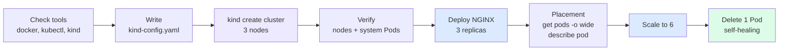

All commands were typed in **PowerShell**, one at a time, from `C:\Users\Admin\k8s-lab`. The 7 screenshots were renamed in the order they were taken (`01` … `07`) and saved in [`screenshots/`](screenshots). Every output was also typed into text files in [`results/raw/`](results/raw), and the numbers used for the tables and graphs are in [`results/processed/`](results/processed).

---

## 6. Part A — Tools and Checks (Manual Parts 1–2)

**Part 1 (installation)** had already been done on this PC: WSL 2, Docker Desktop, kubectl (`winget install -e --id Kubernetes.kubectl`) and kind (`winget install -e --id Kubernetes.kind`). The installation itself was not captured. **Part 2** checked that every tool works:

| Step | Command | Purpose | Result |
|:-:|:--|:--|:--|
| 2.1 | `docker version` | Docker client and server both answer | Client 29.9.2, **Server: Docker Desktop 4.97.0**, Engine 29.9.2 (linux/amd64) |
| 2.2 | `docker run hello-world` | Containers can be downloaded and run | Image pulled, **"Hello from Docker!"** |
| 2.3 | `kubectl version --client` | kubectl is installed | **Client Version: v1.36.1** |
| 2.4 | `kind version` | kind is installed | **kind v0.33.0** go1.26.7 windows/amd64 |

The Server section of `docker version` is the important part: it proves Docker Desktop's engine was **running**, which kind needs for creating the node containers.

| | |
|:-:|:-:|
| 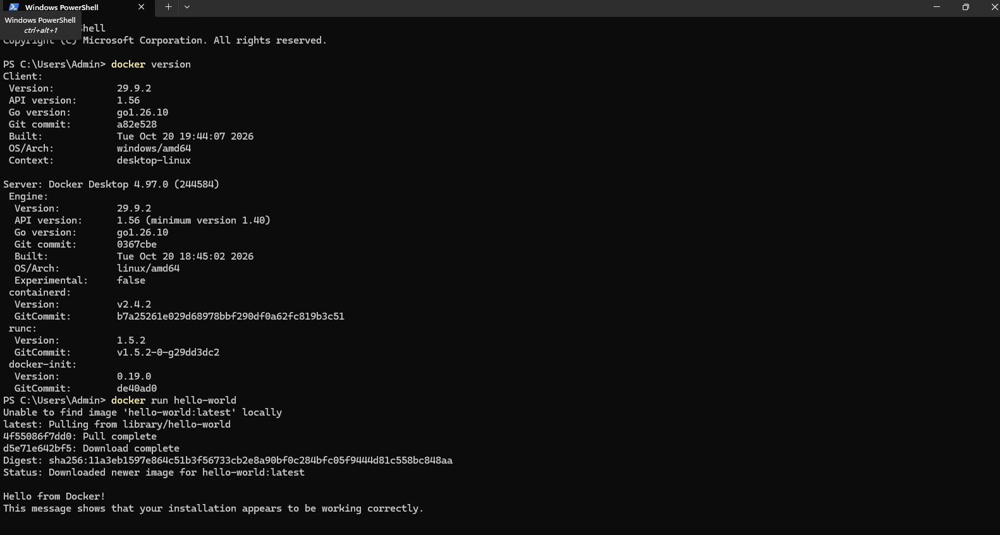<br><em>01 — <code>docker version</code> (Client + Server 29.9.2) and <code>docker run hello-world</code></em> | 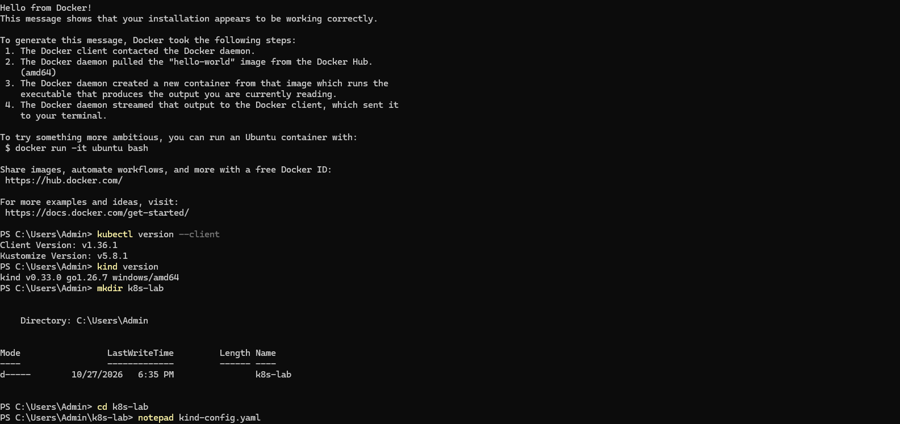<br><em>02 — kubectl v1.36.1, kind v0.33.0, <code>mkdir k8s-lab</code>, <code>notepad kind-config.yaml</code></em> |

---

## 7. Part B — Cluster Configuration File (Manual Part 3)

A cluster with only `kind create cluster` would have **one** node. A short YAML file tells kind to build three. File: [`k8s/kind-config.yaml`](k8s/kind-config.yaml)

```yaml
kind: Cluster
apiVersion: kind.x-k8s.io/v1alpha4
nodes:
- role: control-plane
- role: worker
- role: worker
```

| Line | Meaning |
|:--|:--|
| `kind: Cluster` | This file describes a whole cluster |
| `apiVersion: kind.x-k8s.io/v1alpha4` | The version of kind's configuration format |
| `nodes:` | The list of nodes to create, one entry per node |
| `- role: control-plane` | One node runs the control plane (API server, etcd, scheduler, controller manager) |
| `- role: worker` (×2) | Two nodes run the application Pods |

| Step | Command | Result |
|:-:|:--|:--|
| 3.1 | `mkdir k8s-lab` | Folder created at 6:35 PM |
| 3.2 | `cd k8s-lab` | Prompt ends in `\k8s-lab>` |
| 3.3–3.4 | `notepad kind-config.yaml` | YAML pasted and saved |
| 3.5 | `Get-ChildItem` | `kind-config.yaml`, **118 bytes** (not `.txt`, so it was saved correctly) |

> The copy in this repository has three comment lines at the top, so its size differs from the 118-byte file used in the lab. The configuration lines are identical.

---

## 8. Part C — Building the Three-Node Cluster (Manual Part 4)

### 8.1 Create the cluster (Step 4.1)

```powershell
kind create cluster --config kind-config.yaml
```

```text
Creating cluster "kind" ...
 ✓ Ensuring node image (kindest/node:v1.37.0)
 ✓ Preparing nodes
 ✓ Writing configuration
 ✓ Starting control-plane
 ✓ Installing CNI
 ✓ Installing StorageClass
 ✓ Joining worker nodes
Set kubectl context to "kind-kind"
```

| kind stage | What it does |
|:--|:--|
| Ensuring node image | Downloads `kindest/node:v1.37.0`, the image every node container is started from |
| Preparing nodes | Starts **3 Docker containers**, one per node |
| Starting control-plane | Runs `kubeadm init` inside the control-plane container: API server, etcd, scheduler, controller manager |
| Installing CNI | Installs **kindnet**, so Pods on different nodes can reach each other |
| Installing StorageClass | Adds default storage for volumes |
| Joining worker nodes | The two workers join the control plane |
| Set kubectl context | kubectl now points at this cluster automatically |

### 8.2 Check the cluster (Steps 4.2–4.5)

```text
PS> kubectl cluster-info --context kind-kind
Kubernetes control plane is running at https://127.0.0.1:7295
CoreDNS is running at https://127.0.0.1:7295/api/v1/namespaces/kube-system/services/kube-dns:dns/proxy

PS> kubectl get nodes
NAME                 STATUS   ROLES           AGE     VERSION
kind-control-plane   Ready    control-plane   2m38s   v1.37.0
kind-worker          Ready    <none>          2m29s   v1.37.0
kind-worker2         Ready    <none>          2m29s   v1.37.0
```

**`docker ps`** showed the three nodes as ordinary Docker containers:

| Container ID | Image | Ports | Name = Kubernetes node |
|:--|:--|:--|:--|
| `446b46678d6a` | `kindest/node:v1.37.0` | `127.0.0.1:7295->6443/tcp` | **kind-control-plane** |
| `2a6126e7f3c4` | `kindest/node:v1.37.0` | — | **kind-worker** |
| `84e296cfc528` | `kindest/node:v1.37.0` | — | **kind-worker2** |

Only the control plane publishes a port. `6443` is the Kubernetes API server port inside the container, mapped to `127.0.0.1:7295` on Windows. This is the address in `cluster-info`, and every `kubectl` command goes through it.

### 8.3 System Pods (Step 4.5)

`kubectl get pods -n kube-system -o wide` listed **12 system Pods, all `1/1 Running`, 0 restarts**:

| Component | Pods | Node(s) | IP |
|:--|:-:|:--|:--|
| kube-apiserver | 1 | kind-control-plane | 172.18.0.4 |
| etcd | 1 | kind-control-plane | 172.18.0.4 |
| kube-scheduler | 1 | kind-control-plane | 172.18.0.4 |
| kube-controller-manager | 1 | kind-control-plane | 172.18.0.4 |
| CoreDNS | 2 | kind-control-plane | 10.244.0.2, 10.244.0.3 |
| kube-proxy | 3 | **one on every node** | 172.18.0.4 / .2 / .3 |
| kindnet | 3 | **one on every node** | 172.18.0.4 / .2 / .3 |

Two kinds of IP address appear:
- **172.18.0.x** is the **node's own address** on Docker's network. Pods that manage the node itself (etcd, API server, kube-proxy, kindnet) use the node's network directly.
- **10.244.x.x** is the **Pod network**. Normal Pods such as CoreDNS (and later NGINX) get their own address from the node's Pod range: `10.244.0.x` on the control plane, `10.244.1.x` on `kind-worker2` and `10.244.2.x` on `kind-worker`.

| | |
|:-:|:-:|
| 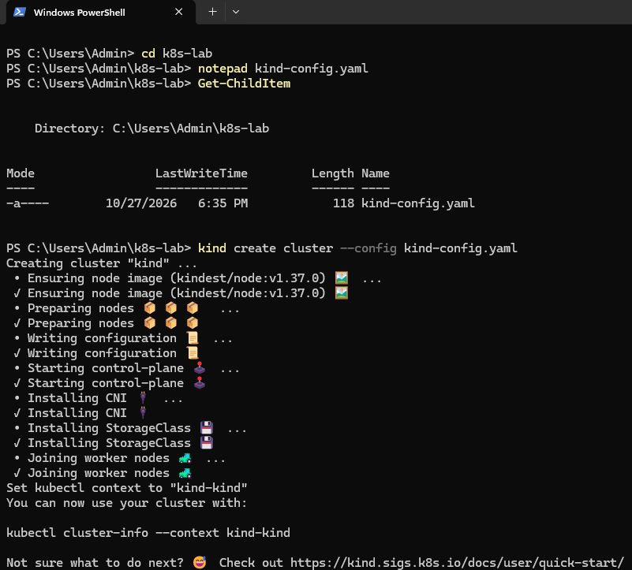<br><em>03 — <code>Get-ChildItem</code> (118-byte YAML) and <code>kind create cluster</code></em> | 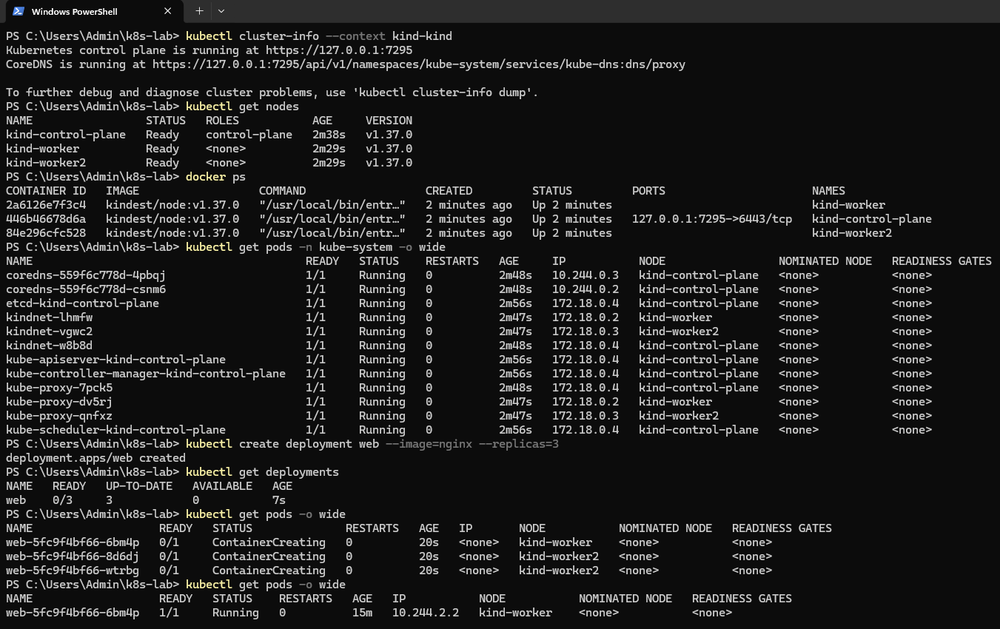<br><em>04 — <code>cluster-info</code>, 3 nodes Ready, <code>docker ps</code>, 12 system Pods, NGINX deployment start</em> |

---

## 9. Part D — Deploying NGINX (Manual Part 5)

### 9.1 Create the Deployment (Steps 5.1–5.2)

```powershell
kubectl create deployment web --image=nginx --replicas=3
```

This one command creates a chain of three objects:

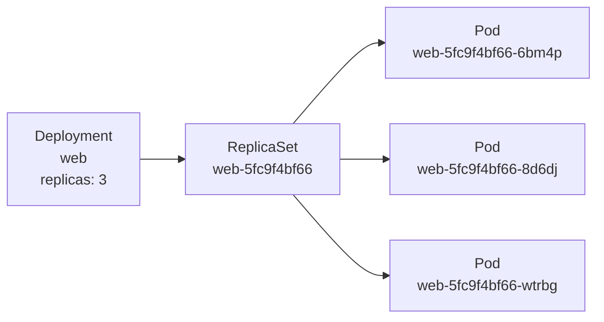

The Pod names show this chain: **`web`** (Deployment) + **`5fc9f4bf66`** (ReplicaSet, from the `pod-template-hash` label) + a random 5-character suffix.

| Time after create | Command | Output |
|:--|:--|:--|
| 7 s | `kubectl get deployments` | `web  0/3  UP-TO-DATE 3  AVAILABLE 0` |
| 20 s | `kubectl get pods -o wide` | 3 Pods **ContainerCreating**, already assigned to nodes, no IP yet |
| about 15 min | `kubectl get pods -o wide` | 3 Pods **1/1 Running** |

### 9.2 Pod placement (Step 5.3)

| Pod | Status | IP | Node |
|:--|:--|:--|:--|
| web-5fc9f4bf66-**6bm4p** | Running | 10.244.2.2 | **kind-worker** |
| web-5fc9f4bf66-**8d6dj** | Running | 10.244.1.3 | **kind-worker2** |
| web-5fc9f4bf66-**wtrbg** | Running | 10.244.1.2 | **kind-worker2** |

**Record (as the manual asks):** Pods on kind-worker = **1**, Pods on kind-worker2 = **2**, Pods on the control plane = **0**.

### 9.3 Inside one Pod (Step 5.4)

`kubectl describe pod web-5fc9f4bf66-6bm4p` (key lines):

| Field | Value | What it tells us |
|:--|:--|:--|
| Node | `kind-worker/172.18.0.2` | The node the scheduler chose |
| Start Time | 27 Oct 2026 **18:45:05** IST | When the Pod was scheduled |
| Labels | `app=web`, `pod-template-hash=5fc9f4bf66` | `app=web` is how the Deployment finds its Pods |
| Controlled By | `ReplicaSet/web-5fc9f4bf66` | The owner that will recreate this Pod if it disappears |
| Container `nginx` Started | **18:46:42** | 97 s after scheduling |
| Restart Count | 0 | — |
| QoS Class | **BestEffort** | No CPU/memory requests or limits were set (Experiment 4 adds them) |
| Tolerations | `not-ready` / `unreachable` for **300 s** | If the node fails, the Pod is moved after 5 minutes |

**Events** (the Pod's history):

| Type | Reason | From | Message |
|:--|:--|:--|:--|
| Normal | **Scheduled** | default-scheduler | **Successfully assigned default/web-5fc9f4bf66-6bm4p to kind-worker** |
| Normal | Pulling | kubelet | Pulling image "nginx" |
| Normal | **Pulled** | kubelet | Successfully pulled image "nginx" in **1m36.352s**. Image size: **63,903,938 bytes** |
| Normal | Created | kubelet | Container created |
| Normal | Started | kubelet | Container started |

The `Scheduled` event is the **scheduler's decision**, which is exactly what the manual asks you to find. The next four events come from the **kubelet**, the agent on `kind-worker` that actually downloads the image and starts the container.

| | |
|:-:|:-:|
| 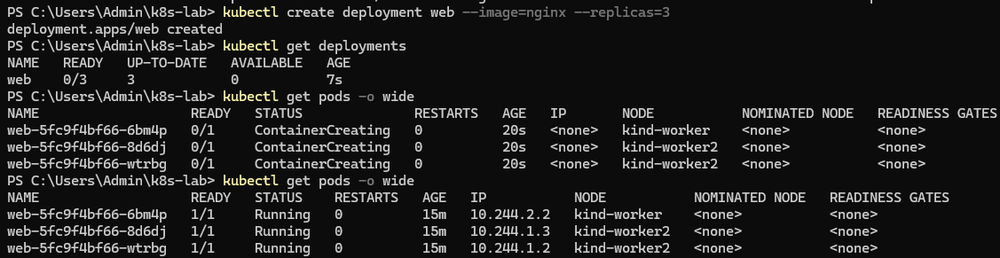<br><em>05 — <code>create deployment</code>, 0/3 at 7 s, ContainerCreating at 20 s, 3 Running after 15 min</em> | 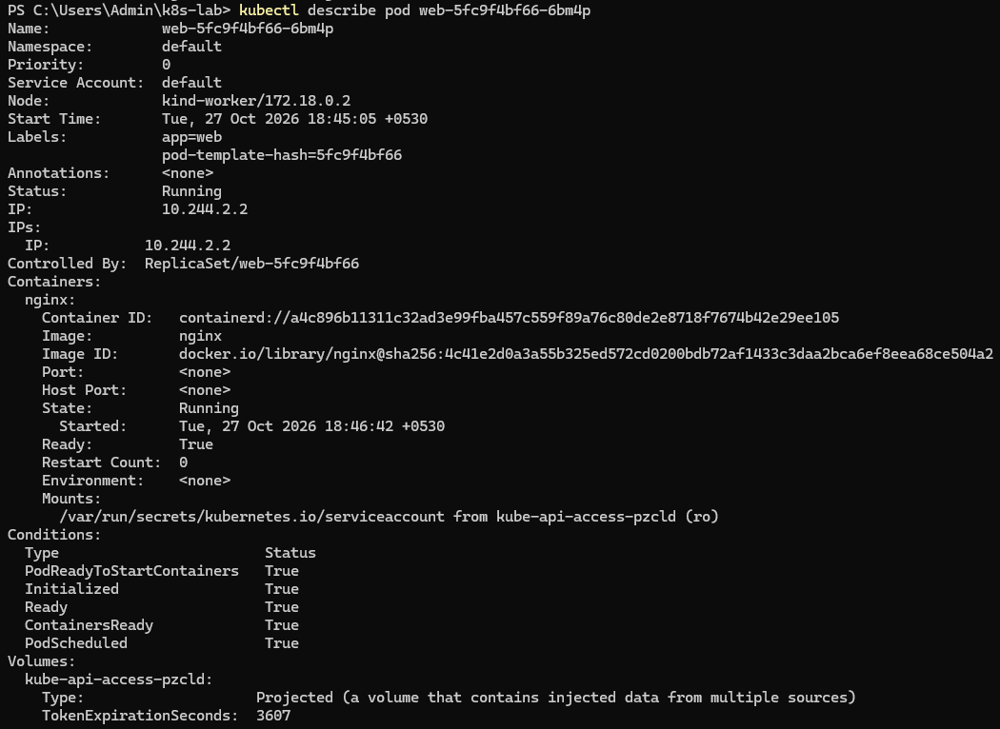<br><em>06 — <code>kubectl describe pod</code>: node, labels, ReplicaSet owner, container state</em> |

---

## 10. Part E — Scaling and Self-Healing (Manual Part 6)

### 10.1 Scale from 3 to 6 (Steps 6.1–6.2)

```powershell
kubectl scale deployment web --replicas=6
kubectl get pods -o wide
```

| Pod | AGE | IP | Node | |
|:--|:-:|:--|:--|:--|
| web-…-6bm4p | 19m | 10.244.2.2 | kind-worker | original |
| web-…-8d6dj | 19m | 10.244.1.3 | kind-worker2 | original |
| web-…-wtrbg | 19m | 10.244.1.2 | kind-worker2 | original |
| web-…-**j7cfp** | **10s** | 10.244.2.3 | kind-worker | **new** |
| web-…-**pxgnr** | **10s** | 10.244.2.4 | kind-worker | **new** |
| web-…-**vflfn** | **10s** | 10.244.1.4 | kind-worker2 | **new** |

**Record:** Pods on kind-worker = **3**, Pods on kind-worker2 = **3**. All 6 were `1/1 Running`.

The scheduler put **two of the three new Pods on `kind-worker`**, the node that had only one Pod. This **evened out** the two workers to 3 + 3.

### 10.2 Delete a Pod and watch it come back (Steps 6.3–6.4)

```powershell
kubectl delete pod web-5fc9f4bf66-6bm4p
# pod "web-5fc9f4bf66-6bm4p" deleted from default namespace
kubectl get pods
```

| Pod | Status | AGE | |
|:--|:--|:-:|:--|
| web-…-8d6dj | Running | 19m | |
| web-…-**bkrvs** | **Running** | **14s** | **replacement, created by Kubernetes** |
| web-…-j7cfp | Running | 50s | |
| web-…-pxgnr | Running | 50s | |
| web-…-vflfn | Running | 50s | |
| web-…-wtrbg | Running | 19m | |

**What happened, step by step:**

1. `kubectl delete pod` removed Pod `6bm4p`. The **actual** count fell to **5**.
2. The **ReplicaSet controller** (inside `kube-controller-manager`) compared actual (5) with desired (6) and created **one new Pod**, `bkrvs`.
3. The **scheduler** placed it on a node, and the **kubelet** started it. The image was already on the node, so this took seconds.
4. **14 s** later the Deployment was back to **6/6 Running**. Nobody typed a command to recreate it.

The replacement has a **new name and a new IP**. Kubernetes does not "repair" a Pod: it **replaces** it. This is why applications should never depend on a Pod's name or IP (Experiment 4 uses a Service to solve this).

> **Which node did `bkrvs` go to?** `kubectl get pods` without `-o wide` does not show the node. The next lab session (Experiment 4, screenshot 01) uses the same cluster and shows `web-5fc9f4bf66-bkrvs` on **kind-worker**, the same node the deleted Pod was on. So the final layout stayed **3 + 3**.

<p align="center">
  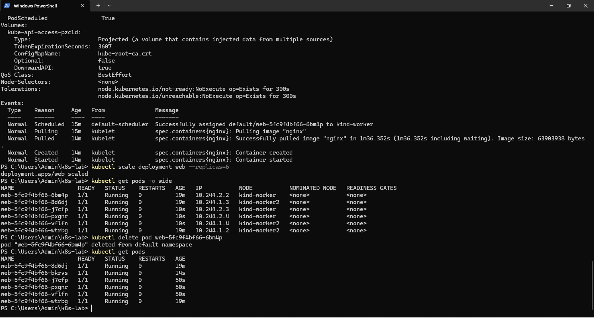<br>
  <em>07 — End of <code>describe pod</code> (QoS BestEffort, Events), <code>kubectl scale --replicas=6</code>, six Pods across both workers, <code>kubectl delete pod</code> and the replacement <code>bkrvs</code> (AGE 14s).</em>
</p>

---

## 11. Consolidated Results

### 11.1 Observation table

| Observation | Result |
|:--|:--|
| Nodes | **3/3 Ready**, all v1.37.0 (1 control plane, 2 workers) |
| Node containers (`docker ps`) | 3 × `kindest/node:v1.37.0`, API on `127.0.0.1:7295` |
| System Pods | **12/12 Running**, 0 restarts (8 on control plane, 2 on each worker) |
| Deployment `web` after create | 0/3 at 7 s → 3/3 Running |
| Placement with 3 replicas | kind-worker **1**, kind-worker2 **2**, control plane 0 |
| First Pod start-up | **97 s** (image pull 96.4 s for 63.9 MB) |
| Placement with 6 replicas | kind-worker **3**, kind-worker2 **3**, control plane 0 |
| New Pods after scaling | Running when **10 s** old |
| Self-healing | Deleted Pod replaced by `bkrvs`; **6/6 Running**, replacement **14 s** old |
| Pod QoS class | BestEffort (no requests or limits) |

### 11.2 Pod count at each check

| Check | Desired | Running | kind-worker | kind-worker2 | control plane |
|:--|:-:|:-:|:-:|:-:|:-:|
| 20 s after create | 3 | 0 | 1 | 2 | 0 |
| about 15 min later | 3 | **3** | 1 | 2 | 0 |
| after scale to 6 | 6 | **6** | 3 | 3 | 0 |
| after deleting 1 Pod | 6 | **6** | 3 | 3 | 0 |

Raw outputs: [`results/raw/`](results/raw) · Processed data: [`results/processed/`](results/processed)

---

## 12. Analysis

All graphs are generated with **matplotlib** by [`scripts/generate_graphs.py`](scripts/generate_graphs.py) from the CSV files in `results/processed/`. This experiment is about **behaviour** (placement, start-up, recovery), not speed, so the graphs show counts and times read from the screenshots.

### 12.1 The cluster that was built

<p align="center">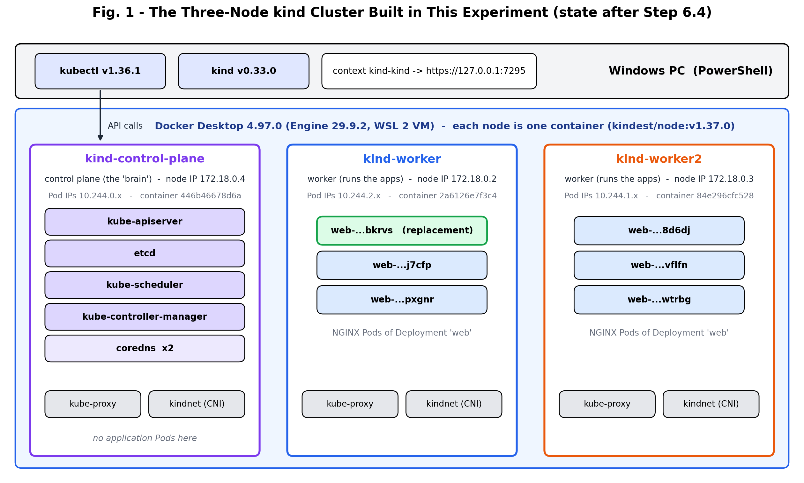</p>

**What the figure shows:**
- One Windows PC, one Docker Desktop, and **three containers that behave as three separate machines**, each with its own IP (172.18.0.2–.4) and its own Pod address range.
- All the "brain" components live on `kind-control-plane`. The two workers only carry kube-proxy, kindnet and the application.
- After Part 6, each worker runs **3 NGINX Pods**, including the replacement `bkrvs`.

### 12.2 System Pods on each node

<p align="center">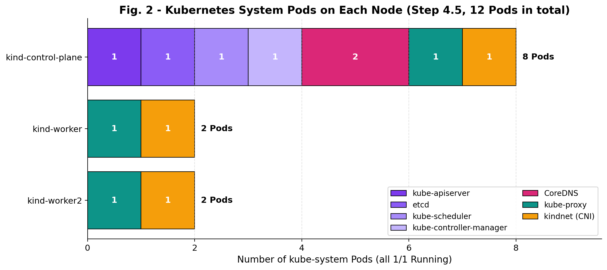</p>

**What the graph shows:**
- The control plane runs **8** system Pods: the four control-plane components, two CoreDNS Pods, and one kube-proxy and one kindnet.
- Each worker runs exactly **2**: **kube-proxy** and **kindnet**. These two run on **every** node, because every node needs Pod networking and Service rules. Kubernetes runs them as **DaemonSets** (one copy per node).

### 12.3 Pod placement

<p align="center">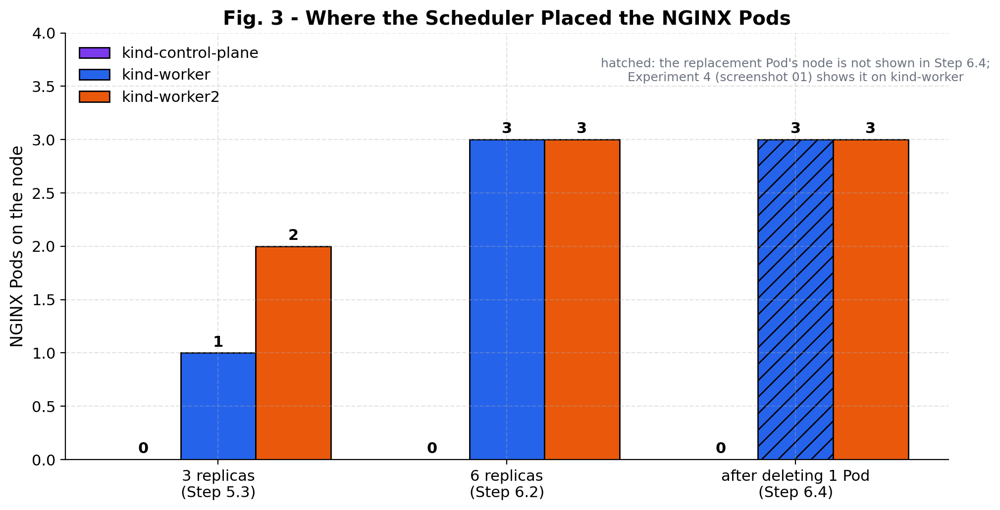</p>

**What the graph shows:**
- **No NGINX Pod ever ran on the control plane.** kind marks the control-plane node so that normal application Pods are not scheduled there, keeping the "brain" free for cluster work.
- With 3 Pods the split was **1 + 2**: 3 cannot be divided evenly between 2 workers.
- With 6 Pods the split became **3 + 3**. The scheduler gave 2 of the 3 new Pods to `kind-worker`, the emptier node. By default it scores nodes and prefers to **spread** Pods of the same Deployment across nodes, so one node failure cannot take down most of the copies.
- After the self-healing test the split was still **3 + 3**.

### 12.4 Desired vs running

<p align="center">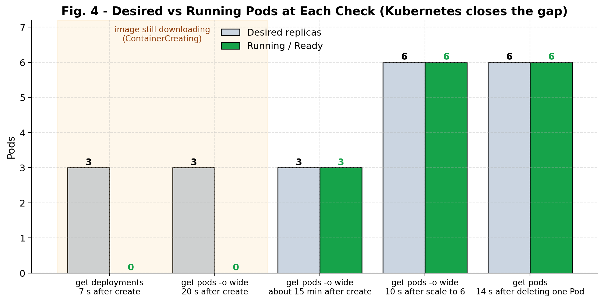</p>

**What the graph shows:**
- Right after `create deployment`, Kubernetes **accepted** the request immediately (desired = 3), but **0** Pods were running at 7 s and 20 s. The Pods had been scheduled but were still `ContainerCreating`.
- Every later check shows **desired = running**. Kubernetes keeps working until the two numbers match, whether the gap is caused by a new Deployment, a scale-up or a deleted Pod.

### 12.5 Where the start-up time went

<p align="center">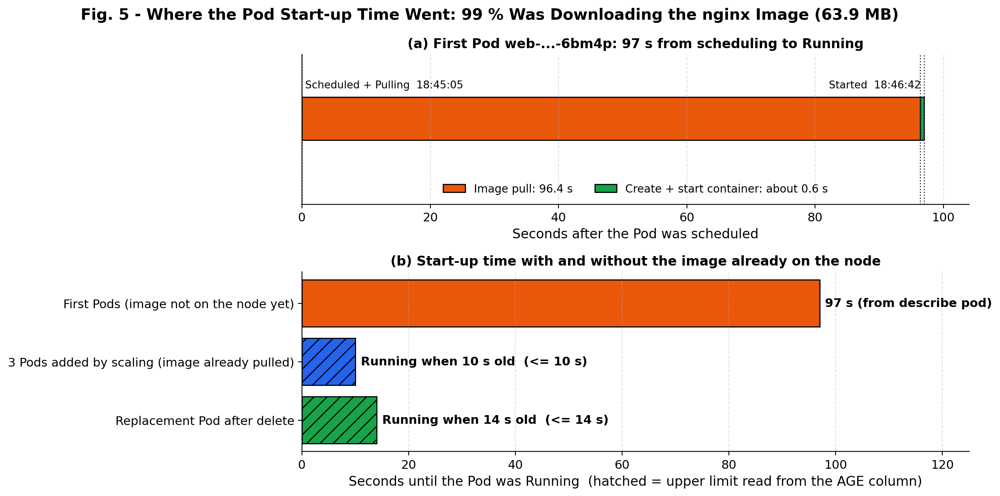</p>

**What the graph shows:**
- **(a)** For the first Pod, 96.4 of the 97 seconds (**99 %**) were spent **downloading the `nginx` image** (63.9 MB, an average of about 0.66 MB/s including unpacking). Creating and starting the container took **less than one second**.
- **(b)** Once both workers had the image, new Pods were Running within **10 s** (scale-up) and **14 s** (replacement). The hatched bars are upper limits, because the AGE column was read once, not timed.
- **Lesson:** a container starts in about a second; the slow part is **getting the image to the node the first time**. Production clusters pre-pull images or use a nearby registry for this reason.

### 12.6 Pod lifetimes: scaling and self-healing

<p align="center">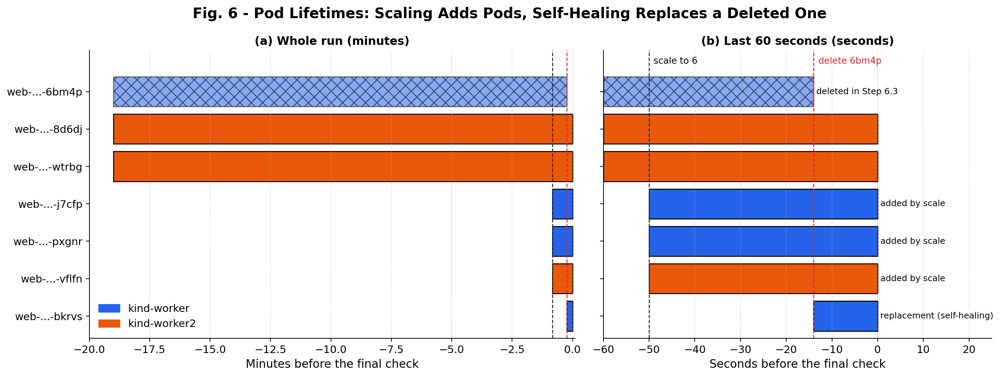</p>

**What the graph shows:**
- **(a)** Three Pods lived through the whole 19-minute session (one of them, `6bm4p`, until it was deleted).
- **(b)** Zoomed to the last minute: the scale command added 3 Pods about **50 s** before the final check. `6bm4p` was deleted about **14 s** before it, and **`bkrvs` appears at the same moment**. The deleted Pod's lifetime ends exactly where the replacement's begins.
- Times come from the AGE column. kubectl rounds AGE values over 10 minutes to whole minutes, so the 19-minute bars are approximate.

### 12.7 Summary dashboard

<p align="center">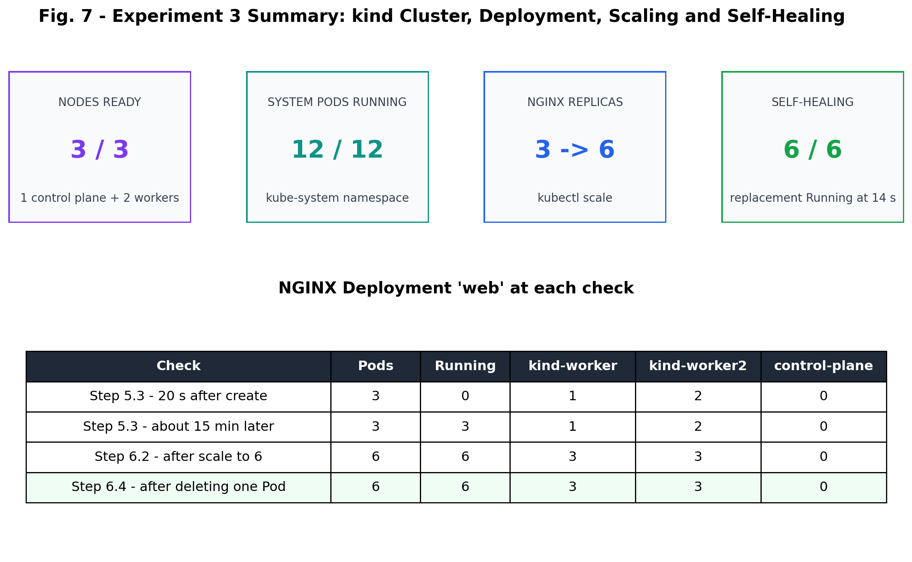</p>

---

## 13. Docker Compose vs Kubernetes — Comparison

The Cloud Computing lab evaluation ran a multi-container application with **Docker Compose**. This experiment ran containers with **Kubernetes**. The table compares the two from what was actually done.

| Aspect | Docker Compose (lab evaluation) | Kubernetes / kind (this experiment) |
|:--|:--|:--|
| Machines | One Docker host | A **cluster** of nodes (here 3, as containers) |
| Who chooses where a container runs | You (it runs on the one host) | The **scheduler** (`Successfully assigned … to kind-worker`) |
| Basic unit | Container | **Pod** (one or more containers with one IP) |
| Copies of a service | `--scale`, all on one host | `--replicas=6`, **spread across nodes** (3 + 3) |
| A container is deleted | It stays gone (restart policies cover crashes only) | The **ReplicaSet recreates it** (`bkrvs` in 14 s) |
| State stored in | The YAML file and Docker | **etcd**, read by control loops |
| Command | `docker compose up -d` | `kubectl create / scale / delete` |
| Best for | Development, single-machine apps | Production, many machines, automatic recovery |

---

## 14. Observations and Limitations

**Observations:**

1. kind built a working **three-node** cluster with a single command, and all nodes were `Ready` within about 2.5 minutes.
2. The **control-plane components** all ran on `kind-control-plane`; **kube-proxy and kindnet** ran on every node.
3. **Application Pods never ran on the control plane.** They were split across the two workers (1 + 2, then 3 + 3).
4. The **first** Pod start was slow (97 s) only because of the image download. Later Pods started in seconds.
5. Deleting a Pod did not reduce the Deployment: a **replacement with a new name and IP** was Running within 14 s.

**Limitations:**

| Limitation | Effect |
|:--|:--|
| Installation (Part 1) was not captured | The tools were already installed. Their versions are proven by Part 2 |
| Host hardware and Docker Desktop's CPU/RAM limits were not recorded | The cluster's capacity is unknown. It does not affect this experiment's results |
| Times read from the **AGE** column | AGE is rounded (whole minutes above 10 min), so the scale and self-heal times are **upper limits**, not exact |
| `kubectl get pods -w` (optional live watch) was not used | The exact moment the replacement became Running was not recorded |
| Step 6.4 used `kubectl get pods` without `-o wide` | The replacement's node was confirmed only later, in Experiment 4 |
| kind is a **simulation** of a multi-machine cluster | All nodes share one PC: a "node failure" here cannot be a real hardware failure |

---

## 15. Troubleshooting and Issues Encountered

### 15.1 Things seen during this experiment

No step failed. These outputs could look like problems but were normal:

| What was seen | Screenshot | Why it happened | Action |
|:--|:-:|:--|:--|
| `web  0/3` READY at 7 s | 04 | The Pods were created but the image was still downloading | Wait and check again |
| `ContainerCreating`, IP `<none>` at 20 s | 04–05 | Same: the kubelet was pulling `nginx` (took 1m36s) | Wait. `kubectl describe pod` shows `Pulling` in Events |
| kubectl v1.36.1 while the manual's sample shows v1.37.x | 02 | winget installed a slightly older kubectl | None needed: one minor version of difference is supported |
| Replacement Pod has a different name and IP | 07 | Kubernetes creates a **new** Pod; it does not restart the deleted one | Expected behaviour |

### 15.2 General troubleshooting guide (from the manual)

| Problem | Solution |
|:--|:--|
| `Cannot connect to the Docker daemon` / `error during connect` | Open Docker Desktop and wait for **Engine running** |
| `kubectl` or `kind` is not recognized | Close every PowerShell window and open a new one (Step 1.5) |
| WSL 2 or virtualization missing | `wsl --install` as Administrator, restart; enable VT-x / AMD-V in BIOS/UEFI |
| A node stays `NotReady` | Wait 1–2 minutes. Still stuck: `kind delete cluster`, then repeat Step 4.1 |
| A Pod shows `ImagePullBackOff` | No internet or a typo in the image name. `kubectl describe pod <name>` shows the error |
| `error parsing kind-config.yaml` | The file has tabs or wrong spacing. Re-copy it exactly (spaces only) |
| File saved as `kind-config.yaml.txt` | In Notepad choose **Save as type: All files** |
| Commands hang in Git Bash | Use PowerShell |

---

## 16. Important Terms

| Term | Meaning |
|:--|:--|
| **Kubernetes (K8s)** | A system that runs and manages containers across a cluster of machines |
| **Container orchestration** | Automatic placement, scaling and recovery of containers |
| **kind** | Kubernetes IN Docker: runs each Kubernetes node as a Docker container |
| **Cluster / Node** | A group of machines managed together / one machine in it |
| **Control plane** | The nodes and components that store state and make decisions |
| **Worker node** | A node that runs application Pods |
| **Pod** | The smallest deployable unit: one or more containers sharing an IP address |
| **Deployment** | Declares which image to run and how many replicas |
| **ReplicaSet** | Keeps the declared number of Pods running |
| **Replica** | One copy of a Pod |
| **Scheduler** | Picks the node for each new Pod |
| **kubelet** | The agent on each node that starts containers |
| **etcd** | The key-value database holding the cluster state |
| **CNI (kindnet)** | The plugin that gives Pods IP addresses and connects them |
| **DaemonSet** | Runs one copy of a Pod on every node (kube-proxy, kindnet) |
| **Desired / actual state** | What you asked for / what is really running |
| **Self-healing** | Kubernetes replacing failed or deleted Pods automatically |
| **QoS class (BestEffort)** | Priority class of a Pod; BestEffort = no CPU/memory requests or limits |
| **Context** | The cluster kubectl is currently connected to (`kind-kind`) |

---

## 17. Conclusion

A complete **three-node Kubernetes cluster** (one control plane, two workers) was built on a Windows PC with **kind v0.33.0** and **Kubernetes v1.37.0**, using Docker Desktop to run each node as a container.

- **Cluster:** all 3 nodes became `Ready` and all **12 system Pods** were `Running`. The control-plane components (API server, etcd, scheduler, controller manager, CoreDNS) ran on the control plane, and kube-proxy and kindnet ran on every node.
- **Deployment:** one command created a Deployment, a ReplicaSet and **3 NGINX Pods**. The scheduler placed them **1 + 2** on the workers and none on the control plane. The first start took 97 s, **99 % of it the image download**.
- **Scaling:** changing the desired count to **6** produced **3 + 3** Pods, which were Running within 10 s.
- **Self-healing:** after a Pod was deleted, the ReplicaSet controller created a **replacement** on its own, and the Deployment was back at **6/6** within 14 s.

**Key lesson:** in Kubernetes you **declare the desired state** and the control plane keeps working until reality matches it. Scaling and self-healing are the same mechanism. This is what makes Kubernetes the base of modern cloud platforms. The cluster built here is reused in **Experiment 4** to study resource requests, scheduling and load balancing.

---

## 18. Repository Structure and Reproduction

```text
CC_Experiment_3/
├── README.md                          ← this report
├── k8s/
│   └── kind-config.yaml               ← 1 control-plane + 2 worker nodes (manual Step 3.4)
├── screenshots/                       ← 7 screenshots, renamed in execution order (01 … 07)
├── scripts/
│   ├── lab_commands.ps1               ← every PowerShell command of Parts 1–6, in order
│   └── generate_graphs.py             ← matplotlib graphs for this report
├── results/
│   ├── raw/                           ← command outputs transcribed from the screenshots
│   │   ├── 01_tool_checks.txt
│   │   ├── 02_create_cluster.txt
│   │   ├── 03_cluster_status.txt
│   │   ├── 04_deploy_nginx.txt
│   │   ├── 05_describe_pod.txt
│   │   └── 06_scale_and_self_heal.txt
│   └── processed/                     ← clean CSVs used for tables and graphs
│       ├── tool_versions.csv
│       ├── cluster_nodes.csv
│       ├── system_pods.csv
│       ├── web_pod_snapshots.csv
│       ├── replica_checkpoints.csv
│       ├── pod_startup_events.csv
│       └── step_status.csv
└── graphs/                            ← 7 generated figures
```

**Reproduce (PowerShell, Docker Desktop running):**

```powershell
kind create cluster --config k8s/kind-config.yaml
kubectl get nodes
kubectl get pods -n kube-system -o wide
kubectl create deployment web --image=nginx --replicas=3
kubectl get pods -o wide
kubectl scale deployment web --replicas=6
kubectl delete pod <one-web-pod-name>
kubectl get pods -o wide
# the full sequence is in scripts/lab_commands.ps1
```

**Regenerate the graphs:**

```bash
pip install matplotlib pandas
python scripts/generate_graphs.py
```

**Clean up** (only when finished; Experiment 4 reuses this cluster):

```powershell
kubectl delete deployment web
kind delete cluster
```

---

## 19. References

1. The Kubernetes Authors, *Kubernetes Documentation* — Concepts: Cluster Architecture, Pods, Deployments, ReplicaSet, Scheduler. https://kubernetes.io/docs/
2. The Kubernetes Authors, *kind — Quick Start and Configuration*. https://kind.sigs.k8s.io/
3. The Kubernetes Authors, *kubectl Reference* and *Version Skew Policy*.
4. Docker Inc., *Docker Desktop for Windows — WSL 2 backend*.
5. B. Burns, J. Beda, K. Hightower and L. Evenson, *Kubernetes: Up and Running*, 3rd ed., O'Reilly, 2022.
6. A. Verma et al., "Large-scale cluster management at Google with Borg," *EuroSys*, 2015.
7. *Kubernetes Lab on Windows — Student Lab Manual, Steps 1–6*, Cloud Computing Laboratory.

---

<div align="center"><sub>Experiment 3 · Cloud Computing Laboratory</sub></div>
