<div align="center">

# Experiment 4 — Resource Allocation, Scheduling and Load Balancing in a Three-Node Kubernetes Cluster
### CPU / Memory Requests and Limits · Pod Distribution at 6 and 12 Replicas · NodePort Service

**Course:** Cloud Computing Laboratory
**Cluster:** the three-node kind cluster built in Experiment 3 (1 control plane + 2 workers, Kubernetes v1.37.0)
**Tools:** kubectl · Deployment and Service YAML · curl (`curlimages/curl`) · `kubectl port-forward`


</div>

---

## Abstract

When many applications share a cluster, Kubernetes must decide **how much CPU and memory each one may use** and **which node each Pod should run on**. It must also let clients reach the Pods even though Pods come and go.

In this experiment, the three-node kind cluster from Experiment 3 was reused. A Deployment called `resource-demo` was created with **CPU and memory requests and limits** (request 100m CPU / 64 MiB, limit 200m CPU / 128 MiB per Pod). It was scaled from 6 to 12 replicas, and a **NodePort Service** was put in front of it:

- **Scheduling:** 6 replicas were placed **3 + 3** on the two workers, and 12 replicas **6 + 6**. **None** ran on the control plane.
- **Resource allocation** (calculated from the YAML and the placement): at 12 replicas each worker had **600m CPU and 384 MiB** reserved by requests, with limits of **1200m CPU and 768 MiB**. That is **1.2 CPU cores and 768 MiB** for the whole Deployment.
- **Load balancing:** the Service `nginx-service` (ClusterIP `10.96.58.123`, NodePort `30080`) registered all **12 Pods as endpoints**. A request from a test Pod to `http://nginx-service:80` returned the **"Welcome to nginx!"** page.

`kubectl top` (Steps 2, 5 and 10), `kubectl describe nodes`, the scheduling events, the EndpointSlices and the optional extension were **not captured**. This report marks those results as "Not captured" and gives a script that completes them.

---

## Table of Contents

1. [Introduction](#1-introduction)
2. [Aim and Objectives](#2-aim-and-objectives)
3. [Basic Concepts](#3-basic-concepts)
4. [Experimental Setup](#4-experimental-setup)
5. [Methodology and Workflow](#5-methodology-and-workflow)
6. [Part A — Verify the Cluster (Steps 1–2)](#6-part-a--verify-the-cluster-steps-12)
7. [Part B — Deployment with Requests and Limits (Steps 3–5)](#7-part-b--deployment-with-requests-and-limits-steps-35)
8. [Part C — Scaling to 12 Replicas (Step 6)](#8-part-c--scaling-to-12-replicas-step-6)
9. [Part D — Service and Load Balancing (Steps 7–9)](#9-part-d--service-and-load-balancing-steps-79)
10. [Part E — Final Utilisation and Clean-up (Steps 10–11)](#10-part-e--final-utilisation-and-clean-up-steps-1011)
11. [Consolidated Results](#11-consolidated-results)
12. [Analysis](#12-analysis)
13. [Requests vs Limits vs Actual Usage — Comparison](#13-requests-vs-limits-vs-actual-usage--comparison)
14. [Observations and Limitations](#14-observations-and-limitations)
15. [Troubleshooting and Issues Encountered](#15-troubleshooting-and-issues-encountered)
16. [Important Terms](#16-important-terms)
17. [Conclusion and Future Work](#17-conclusion-and-future-work)
18. [Repository Structure and Reproduction](#18-repository-structure-and-reproduction)
19. [References](#19-references)

---

## 1. Introduction

Experiment 3 showed that Kubernetes can **run, scale and heal** Pods. Three questions were left open:

| Question | Kubernetes feature | Tested in |
|:--|:--|:--|
| How much CPU and memory may each Pod use? | **Requests and limits** | Steps 3, 5 |
| How does Kubernetes choose a node for each Pod? | The **scheduler** | Steps 4, 6 |
| Pods get new names and IPs when replaced. How do clients find them? | A **Service** with load balancing | Steps 7–9 |

In a shared cloud cluster these questions decide **cost** (how much hardware is reserved), **reliability** (Pods spread over nodes) and **availability** (one stable address in front of changing Pods).

---

## 2. Aim and Objectives

**Aim** (from the lab manual): To analyze resource allocation, pod scheduling, and load balancing in an existing three-node Kubernetes cluster by deploying applications, configuring CPU and memory requests and limits, observing pod distribution, and testing Service load balancing.

**Objectives:**

| # | Objective | Manual steps |
|:-:|:--|:-:|
| 1 | Verify the three-node cluster and its resource usage | 1–2 |
| 2 | Deploy 6 NGINX replicas with CPU and memory requests and limits | 3 |
| 3 | Observe how the scheduler distributes the Pods | 4–5 |
| 4 | Scale to 12 replicas and compare the distribution | 6 |
| 5 | Expose the Pods through a NodePort Service and check its endpoints | 7–8 |
| 6 | Access the application through the Service | 9 |
| 7 | Compare resource use before and after scaling, then clean up | 10–11 |

---

## 3. Basic Concepts

### 3.1 Requests and limits

Every container can declare two numbers for CPU and for memory:

| | **Request** | **Limit** |
|:--|:--|:--|
| Meaning | The amount **reserved** for the container | The **maximum** the container may use |
| Used by | The **scheduler**, to decide whether a Pod fits on a node | The **kubelet / Linux cgroups**, while the Pod runs |
| If exceeded | Allowed (a container may use more than its request, up to the limit) | **CPU:** slowed down (throttled). **Memory:** the container is killed (`OOMKilled`) |
| In this experiment | `cpu: 100m`, `memory: 64Mi` | `cpu: 200m`, `memory: 128Mi` |

**CPU units:** `1000m` (millicores) = 1 CPU core, so `100m` = 0.1 core. **Memory units:** `Mi` = mebibyte (1,048,576 bytes).

### 3.2 Quality of Service (QoS) classes

Kubernetes puts each Pod in a class from its requests and limits. The class decides which Pods are removed first when a node runs out of memory.

| QoS class | Rule | Pods in this experiment |
|:--|:--|:--|
| **Guaranteed** | requests = limits for every container | — |
| **Burstable** | at least one request, but requests < limits | `resource-demo` (100m < 200m) |
| **BestEffort** | no requests and no limits | `web` from Experiment 3 (`QoS Class: BestEffort` in its `describe pod`) |

### 3.3 How the scheduler picks a node

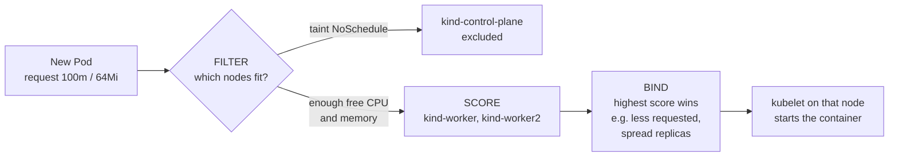

1. **Filter:** remove nodes that cannot run the Pod. For example, a node without enough *unrequested* CPU or memory, or a node with a **taint** the Pod does not tolerate. kind's control-plane node carries a `NoSchedule` taint, so application Pods are filtered out there.
2. **Score:** rank the remaining nodes. Default rules prefer nodes with **more free (unrequested) resources** and **spread Pods of the same Deployment** across nodes.
3. **Bind:** assign the Pod to the best node. The kubelet on that node then starts it.

The scheduler works with **requests, not real usage**. A node can be nearly idle and still refuse a Pod if its requests are full.

### 3.4 Services and load balancing

| Term | Meaning | In this experiment |
|:--|:--|:--|
| **Service** | One stable name and IP in front of a changing set of Pods | `nginx-service` |
| **Selector** | The label used to find the Pods | `app: resource-demo` |
| **ClusterIP** | The Service's virtual IP inside the cluster | `10.96.58.123` |
| **NodePort** | A port opened on **every node** (range 30000–32767) that forwards to the Service | `30080` |
| **Endpoints / EndpointSlice** | The list of Pod IP:port pairs behind the Service | 12 entries |
| **kube-proxy** | Runs on every node and programs the rules that send each **new connection** to one of the endpoints | — |

Kubernetes Service load balancing works **per connection**, not per request, and it does **not** promise an equal number of requests per Pod (the manual says the same).

---

## 4. Experimental Setup

### 4.1 Environment (from the screenshots)

| Item | Value |
|:--|:--|
| Host | Windows PC, user `Admin`, PowerShell, folder `C:\Users\Admin\k8s-lab` |
| Cluster | kind cluster `kind` from Experiment 3, **age 6d23h** |
| Nodes | `kind-control-plane` 172.18.0.4, `kind-worker` 172.18.0.2, `kind-worker2` 172.18.0.3, all **Ready** |
| Kubernetes | v1.37.0 |
| Node OS | Debian GNU/Linux 13 (trixie), kernel **6.18.54.1-microsoft-standard-WSL2** |
| Container runtime | **containerd 2.3.4** (inside each node) |
| Workload | Deployment `resource-demo`, image `nginx`, ReplicaSet `resource-demo-54dfb4bddc` |
| Other Pods already running | 6 `web` Pods from Experiment 3 (3 on each worker) |
| Test client | `curlimages/curl` Pod, and `kubectl port-forward` |
| Date | 3 November 2026, about 18:05 IST |

### 4.2 Manual vs actual

| Item | Manual | Actual |
|:--|:--|:--|
| Cluster | existing three-node cluster | ✅ kind cluster from Experiment 3 |
| `deployment.yaml` | 6 replicas, 100m/64Mi requests, 200m/128Mi limits | ✅ same values ([`k8s/deployment.yaml`](k8s/deployment.yaml)) |
| `service.yaml` | NodePort 30080 → 80 | ✅ same ([`k8s/service.yaml`](k8s/service.yaml)) |
| Metrics Server for `kubectl top` | check with `kubectl get deployment metrics-server -n kube-system` | **Not checked**. kind does not install it by default |
| Step 9 test | browser at `http://NODE-IP:30080` | **In-cluster curl + `kubectl port-forward`** (see Section 9.4 for why) |

> **About the YAML files.** The lab manual's PDF loses the indentation of the YAML. The files in [`k8s/`](k8s) use the correct nesting with exactly the same fields and values, plus comments.

---

## 5. Methodology and Workflow

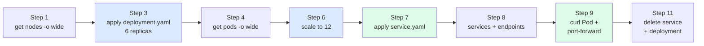

The 4 screenshots were renamed in execution order (`01` … `04`) in [`screenshots/`](screenshots). Every output was typed into [`results/raw/`](results/raw), and the values used for the tables and graphs are in [`results/processed/`](results/processed). Fig. 6 in Section 12 shows which manual steps produced results.

---

## 6. Part A — Verify the Cluster (Steps 1–2)

### 6.1 Step 1 — nodes

```text
PS C:\Users\Admin\k8s-lab> kubectl get nodes -o wide
NAME                 STATUS   ROLES           AGE     VERSION   INTERNAL-IP   OS-IMAGE                       KERNEL-VERSION                     CONTAINER-RUNTIME
kind-control-plane   Ready    control-plane   6d23h   v1.37.0   172.18.0.4    Debian GNU/Linux 13 (trixie)   6.18.54.1-microsoft-standard-WSL2  containerd://2.3.4
kind-worker          Ready    <none>          6d23h   v1.37.0   172.18.0.2    Debian GNU/Linux 13 (trixie)   6.18.54.1-microsoft-standard-WSL2  containerd://2.3.4
kind-worker2         Ready    <none>          6d23h   v1.37.0   172.18.0.3    Debian GNU/Linux 13 (trixie)   6.18.54.1-microsoft-standard-WSL2  containerd://2.3.4
```

| Column | What it shows |
|:--|:--|
| AGE `6d23h` | The cluster built in Experiment 3 (27 Oct) was still there a week later |
| INTERNAL-IP | Each node's address on Docker's network (same as in Experiment 3) |
| OS-IMAGE | The Linux inside each kind node container is **Debian 13** |
| KERNEL-VERSION | `…-microsoft-standard-WSL2`: all three nodes **share the WSL 2 kernel** of Docker Desktop. They are containers, not separate VMs |
| CONTAINER-RUNTIME | Each node runs Pods with **containerd 2.3.4** |

`kind create cluster --config kind-config.yaml` was also typed again and failed with `node(s) already exist for a cluster with the name "kind"`. This is **harmless**: it only confirms that the cluster from Experiment 3 still existed.

### 6.2 Step 2 — resource utilisation before the workload: Not captured

`kubectl top nodes` was **not run**, and neither was the Metrics Server check. **Initial CPU and memory usage per node: Not captured.** The commands are in [`scripts/complete_missing_steps.ps1`](scripts/complete_missing_steps.ps1).

---

## 7. Part B — Deployment with Requests and Limits (Steps 3–5)

### 7.1 Step 3 — `deployment.yaml`

File: [`k8s/deployment.yaml`](k8s/deployment.yaml)

```yaml
apiVersion: apps/v1
kind: Deployment
metadata:
  name: resource-demo
spec:
  replicas: 6
  selector:
    matchLabels:
      app: resource-demo
  template:
    metadata:
      labels:
        app: resource-demo
    spec:
      containers:
      - name: nginx
        image: nginx
        resources:
          requests:
            cpu: "100m"
            memory: "64Mi"
          limits:
            cpu: "200m"
            memory: "128Mi"
```

| Part | Meaning |
|:--|:--|
| `replicas: 6` | Run 6 copies |
| `selector.matchLabels` / `template.metadata.labels` | The Deployment owns every Pod labelled `app: resource-demo`. The Service in Step 7 uses the same label |
| `requests` | 0.1 core and 64 MiB **reserved** for each Pod; the scheduler uses these |
| `limits` | Each Pod may use at most 0.2 core (then throttled) and 128 MiB (then killed) |
| QoS class | requests < limits, so **Burstable** |

```text
PS> kubectl apply -f deployment.yaml
deployment.apps/resource-demo created
```

### 7.2 Step 4 — Pod scheduling (6 replicas)

`kubectl get pods -o wide`, **6 s** after `apply`:

| Pod (`resource-demo-54dfb4bddc-…`) | Status | IP | Node |
|:--|:--|:--|:--|
| 2v8l6 | Running | 10.244.1.6 | kind-worker2 |
| cwlhz | ContainerCreating | — | kind-worker2 |
| mmx2d | Running | 10.244.1.7 | kind-worker2 |
| hmbzm | Running | 10.244.2.6 | kind-worker |
| v4b45 | Running | 10.244.2.5 | kind-worker |
| wcf68 | ContainerCreating | — | kind-worker |

**Distribution with 6 replicas: kind-control-plane 0, kind-worker 3, kind-worker2 3.**

- The node was chosen **immediately**: even Pods still in `ContainerCreating` already show a NODE.
- **4 of 6 were Running within 6 s.** In Experiment 3 the first Pods needed 97 s, because the `nginx` image had to be downloaded first. This time the image was already on both workers.
- The same output also lists the 6 **`web`** Pods from Experiment 3 (3 per worker). They show `RESTARTS 1 (3m59s ago)`: the PC or Docker Desktop had been restarted about 4 minutes earlier, and the cluster **brought every Pod back by itself**.

**Scheduling events** (`kubectl get events --sort-by=.metadata.creationTimestamp`): **Not captured.**

### 7.3 Step 5 — allocated resources: Not captured

`kubectl describe nodes` and `kubectl top pods` were **not run**, so each node's **capacity, allocatable resources and "Allocated resources" section** and the Pods' real usage were not recorded. What *can* be stated exactly is the amount the Deployment **requested**, because it follows directly from the YAML and the measured placement:

| Node | resource-demo Pods (6 replicas) | CPU requests | CPU limits | Memory requests | Memory limits |
|:--|:-:|--:|--:|--:|--:|
| kind-control-plane | 0 | 0 | 0 | 0 | 0 |
| kind-worker | 3 | **300m** | 600m | **192 Mi** | 384 Mi |
| kind-worker2 | 3 | **300m** | 600m | **192 Mi** | 384 Mi |

(3 Pods × 100m = 300m; 3 × 64 Mi = 192 Mi; and so on. The `web` Pods add **0**, because they have no requests.)

| | |
|:-:|:-:|
| 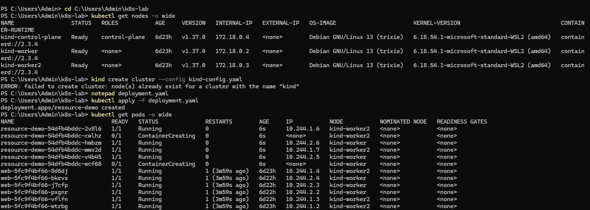<br><em>01 — <code>get nodes -o wide</code>, the harmless <code>kind create cluster</code> error, <code>apply -f deployment.yaml</code>, 6 Pods split 3 + 3</em> | 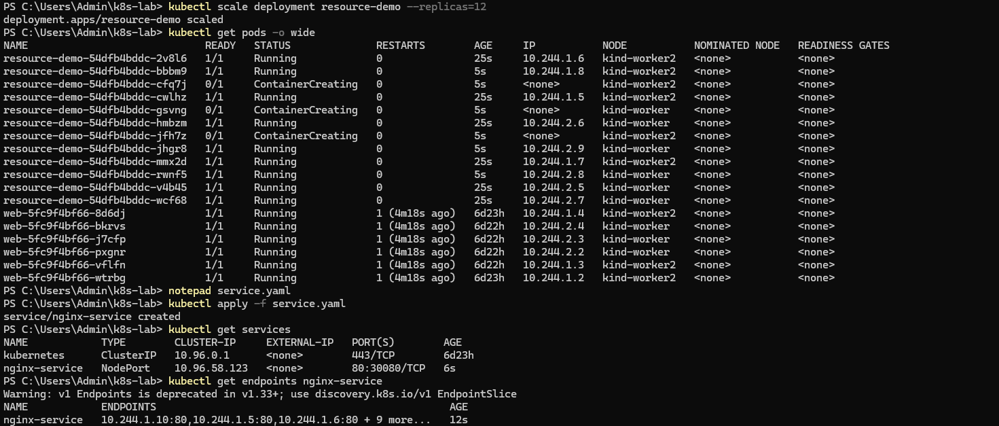<br><em>02 — <code>scale --replicas=12</code> (6 + 6), <code>apply -f service.yaml</code>, <code>get services</code>, <code>get endpoints</code></em> |

---

## 8. Part C — Scaling to 12 Replicas (Step 6)

```text
PS> kubectl scale deployment resource-demo --replicas=12
deployment.apps/resource-demo scaled
```

`kubectl get pods -o wide`, **5 s** after scaling:

| Node | First 6 (age 25 s) | Added by scaling (age 5 s) | resource-demo total |
|:--|:--|:--|:-:|
| kind-worker | hmbzm, v4b45, wcf68 | **gsvng** (creating), **jhgr8**, **rwnf5** | **6** |
| kind-worker2 | 2v8l6, cwlhz, mmx2d | **bbbm9**, **cfq7j** (creating), **jfh7z** (creating) | **6** |
| kind-control-plane | — | — | **0** |

**Distribution with 12 replicas: kind-control-plane 0, kind-worker 6, kind-worker2 6.**

- The 6 new Pods were split **3 + 3** again, so the workers stayed perfectly balanced.
- The 2 Pods that were `ContainerCreating` at the 6-replica check (cwlhz, wcf68) were now **Running**.
- 3 of the 6 new Pods were already Running at 5 s; the other 3 were still starting.
- Requested resources per worker doubled to **600m CPU and 384 Mi memory** (limits 1200m and 768 Mi). See Fig. 4.

---

## 9. Part D — Service and Load Balancing (Steps 7–9)

### 9.1 Step 7 — `service.yaml`

File: [`k8s/service.yaml`](k8s/service.yaml)

```yaml
apiVersion: v1
kind: Service
metadata:
  name: nginx-service
spec:
  type: NodePort
  selector:
    app: resource-demo
  ports:
  - port: 80
    targetPort: 80
    nodePort: 30080
```

| Field | Meaning |
|:--|:--|
| `type: NodePort` | Give the Service a ClusterIP **and** open port 30080 on every node |
| `selector: app: resource-demo` | Send traffic only to Pods with this label. The `web` Pods (`app: web`) are **not** included |
| `port: 80` | The port clients use on the Service |
| `targetPort: 80` | The port NGINX listens on inside each Pod |
| `nodePort: 30080` | The port opened on each node |

### 9.2 Step 8 — Service and endpoints

```text
PS> kubectl get services
NAME            TYPE        CLUSTER-IP     EXTERNAL-IP   PORT(S)        AGE
kubernetes      ClusterIP   10.96.0.1      <none>        443/TCP        6d23h
nginx-service   NodePort    10.96.58.123   <none>        80:30080/TCP   6s

PS> kubectl get endpoints nginx-service
Warning: v1 Endpoints is deprecated in v1.33+; use discovery.k8s.io/v1 EndpointSlice
NAME            ENDPOINTS                                                AGE
nginx-service   10.244.1.10:80,10.244.1.5:80,10.244.1.6:80 + 9 more...   12s
```

- `80:30080/TCP` means: Service port 80, reachable on every node at port 30080.
- **3 endpoints shown + 9 more = 12**, exactly the 12 `resource-demo` Pods. Every Pod became a backend automatically: no IP address was typed anywhere.
- `10.244.1.10` was not in the Step 6 list. It belongs to one of the Pods that was still `ContainerCreating` there (cfq7j or jfh7z on kind-worker2), which got its IP a few seconds later.
- The **deprecation warning** is normal for Kubernetes v1.33 and later: the newer `EndpointSlice` API holds the same information. **`kubectl get endpointslices`: Not captured.**

### 9.3 Step 9 — testing the application

**Test 1: from inside the cluster, through the Service name.**

```text
PS> kubectl run test-curl --rm -i --tty --image=curlimages/curl -- http://nginx-service:80
<!DOCTYPE html>
<html>
<head>
<title>Welcome to nginx!</title>
...
<h1>Welcome to nginx!</h1>
<p>If you see this page, nginx is successfully installed and working.
...
pod "test-curl" deleted from default namespace
```

This started a temporary Pod, ran `curl http://nginx-service:80` inside it, printed the reply and deleted the Pod (`--rm`). The path was: **CoreDNS** turned `nginx-service` into the ClusterIP `10.96.58.123`, then **kube-proxy** sent the connection to one of the 12 endpoints. The NGINX welcome page proves that the Service, its DNS name and its endpoints work.

The page appears **twice** in the screenshot, with the warning `couldn't attach to pod/test-curl, falling back to streaming logs` in between. `curl` finished so quickly that the container had already exited when kubectl tried to attach, so kubectl printed the container's log as well. This was most likely the same single response shown twice, not two requests.

**Test 2: from Windows, with `kubectl port-forward`.**

```text
PS> kubectl port-forward service/nginx-service 30080:80
Forwarding from 127.0.0.1:30080 -> 80
Forwarding from [::1]:30080 -> 80
Handling connection for 30080
Handling connection for 30080
```

kubectl opened `localhost:30080` on Windows, and two connections were handled (for example, a browser loading the page). The browser itself was not captured in a screenshot.

### 9.4 Why `http://NODE-IP:30080` was not used

The manual's Step 9 opens `http://NODE-IP:30080` in a browser. With **kind on Docker Desktop for Windows**, that does not work by default:

- The node IPs (172.18.0.2–.4) belong to Docker's network **inside the WSL 2 virtual machine**. Windows has no route to them.
- kind publishes **only the API server port** to Windows (`127.0.0.1:7295->6443` in Experiment 3's `docker ps`). NodePort 30080 is open on the nodes but **not mapped to the Windows host**.

The manual allows for this ("subject to cluster networking and firewall rules"). The two tests above are the standard alternatives. To use a real NodePort from Windows, the cluster would need `extraPortMappings` for port 30080 in `kind-config.yaml`.

> **Load-balancing caution.** `kubectl port-forward service/...` connects to **one Pod** chosen by kubectl, so it does **not** go through kube-proxy's load balancing. The in-cluster curl test **does** go through the Service. Neither test shows *how* requests were spread over the 12 Pods; as the manual itself says, a successful page "does not by itself prove equal traffic distribution." Section 17.2 gives a command that measures the spread.

| | |
|:-:|:-:|
| 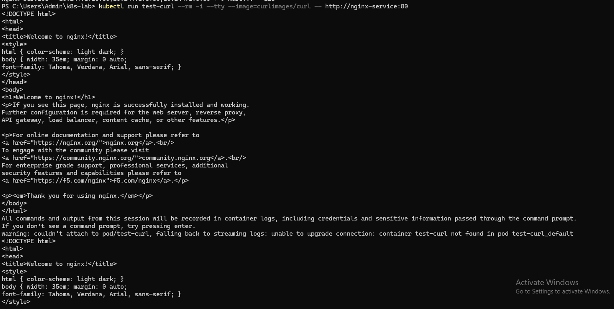<br><em>03 — <code>kubectl run test-curl</code> → <code>http://nginx-service:80</code> returns "Welcome to nginx!"</em> | 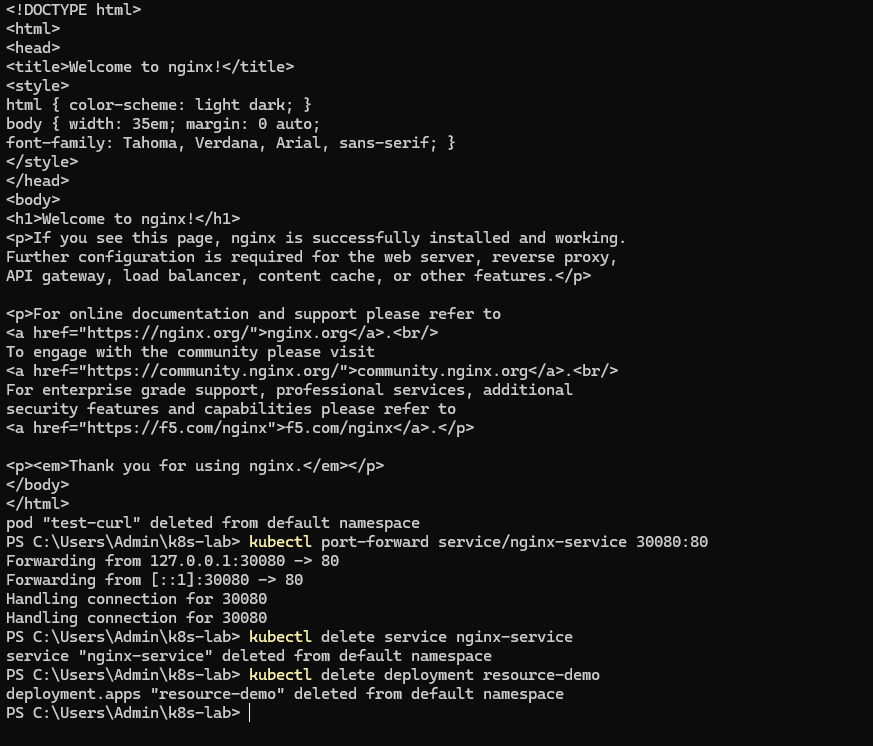<br><em>04 — <code>kubectl port-forward</code> (2 connections), then <code>delete service</code> and <code>delete deployment</code></em> |

---

## 10. Part E — Final Utilisation and Clean-up (Steps 10–11)

**Step 10 (`kubectl top nodes` / `kubectl top pods` after scaling): Not captured.** Without Step 2 or Step 10, the experiment has no before/after **usage** comparison. It does have the exact **requested** resources (Section 7.3 and Fig. 4).

**Step 11 — clean-up:**

```text
PS> kubectl delete service nginx-service
service "nginx-service" deleted from default namespace
PS> kubectl delete deployment resource-demo
deployment.apps "resource-demo" deleted from default namespace
```

The Service and all 12 `resource-demo` Pods were removed, and **the three-node cluster stayed intact**, as the manual intends. The `web` Deployment from Experiment 3 was not part of this experiment and was left running.

---

## 11. Consolidated Results

### 11.1 Observation table (manual Section 4)

| Experiment | Observation to record | Result |
|:--|:--|:--|
| Cluster verification | Status of all three nodes | **3/3 Ready**, v1.37.0, Debian 13, containerd 2.3.4 |
| Initial resource utilization | CPU and memory usage of each node | **Not captured** (`kubectl top nodes` not run) |
| Six replicas | Number of pods scheduled on each node | control-plane **0**, kind-worker **3**, kind-worker2 **3** |
| Twelve replicas | Updated pod distribution across nodes | control-plane **0**, kind-worker **6**, kind-worker2 **6** |
| Resource allocation | CPU and memory requests and limits | Per Pod: request **100m / 64Mi**, limit **200m / 128Mi**. Per worker at 12 replicas: requests **600m / 384Mi**, limits **1200m / 768Mi** (calculated) |
| Load balancing | Service backend endpoints and application response | NodePort `80:30080`, ClusterIP `10.96.58.123`, **12 endpoints**; "Welcome to nginx!" through the Service |
| Final utilization | CPU and memory usage after scaling | **Not captured** (`kubectl top` not run) |

### 11.2 Requested resources for the whole Deployment

| Replicas | CPU requests | CPU limits | Memory requests | Memory limits |
|:-:|--:|--:|--:|--:|
| 6 | 600m (0.6 core) | 1200m | 384 Mi | 768 Mi |
| 12 | **1200m (1.2 cores)** | 2400m | **768 Mi** | 1536 Mi |

### 11.3 Pods running at the first check

| Moment | Running / total | Note |
|:--|:-:|:--|
| 6 s after `apply` (6 replicas) | 4 / 6 | image already on both workers |
| 5 s after `scale` (6 new Pods) | 3 / 6 | — |
| *(Experiment 3, 20 s after create)* | *0 / 3* | *image had to be downloaded (97 s)* |

Raw outputs: [`results/raw/`](results/raw) · Processed data: [`results/processed/`](results/processed)

---

## 12. Analysis

All graphs are generated with **matplotlib** by [`scripts/generate_graphs.py`](scripts/generate_graphs.py) from `results/processed/`. The script also writes [`requested_resources_per_node.csv`](results/processed/requested_resources_per_node.csv) (YAML values × measured placement).

### 12.1 How traffic reached the Pods

<p align="center">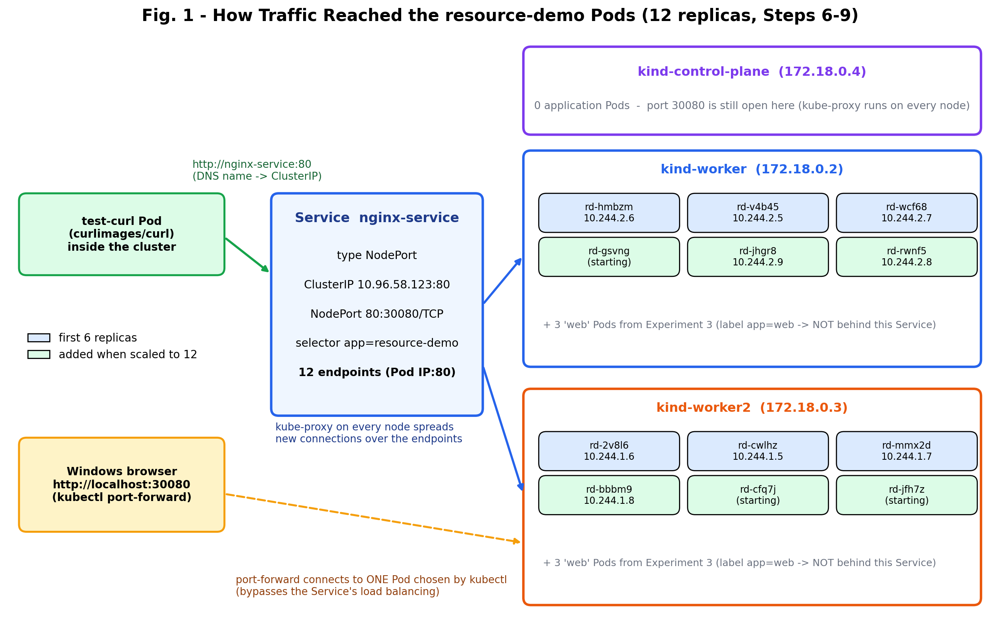</p>

**What the figure shows:**
- The **test-curl Pod** called `nginx-service` by name. The Service (ClusterIP `10.96.58.123`) had **12 endpoints**, 6 on each worker, and kube-proxy sends each new connection to one of them.
- The `web` Pods from Experiment 3 run on the same nodes but are **not** behind this Service, because the selector `app=resource-demo` does not match them.
- The control plane has **no application Pods**, but NodePort 30080 is still open there, because kube-proxy runs on every node.
- The **dashed path** is `kubectl port-forward`: it goes from Windows straight to **one** Pod and skips the Service's load balancing.

### 12.2 Pod distribution: 6 vs 12 replicas

<p align="center">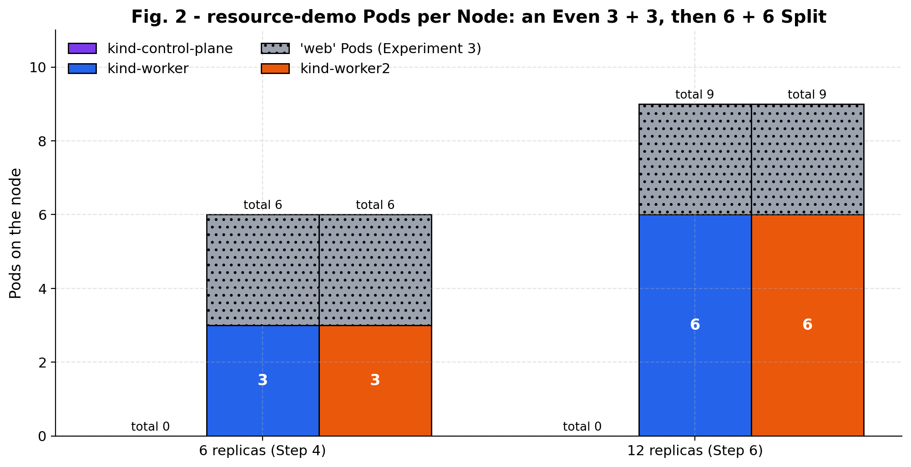</p>

**What the graph shows:**
- **6 replicas → 3 + 3; 12 replicas → 6 + 6.** The scheduler kept the two workers exactly balanced.
- The **control plane stayed at 0**: its `NoSchedule` taint removes it in the Filter phase.
- Each worker also ran 3 `web` Pods (grey). Those Pods have **no requests**, so in the scheduler's view they reserve nothing. Both workers therefore looked equally "free", which most likely explains why the split was perfectly even.

### 12.3 Every Pod and its node

<p align="center">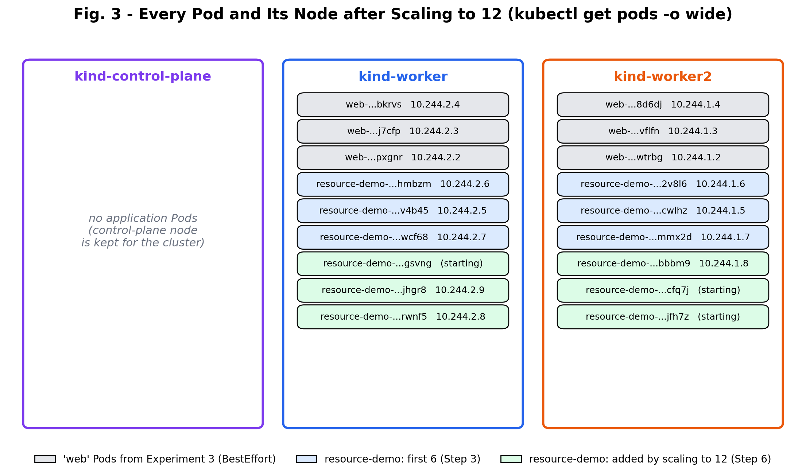</p>

**What the figure shows:** the complete `kubectl get pods -o wide` output after scaling, drawn per node. Each worker received **3 of the first 6** (blue) and **3 of the 6 added** (green) `resource-demo` Pods. The Pod IPs also show each node's Pod range: **10.244.2.x on kind-worker** and **10.244.1.x on kind-worker2**.

### 12.4 Resources reserved and capped on each node

<p align="center">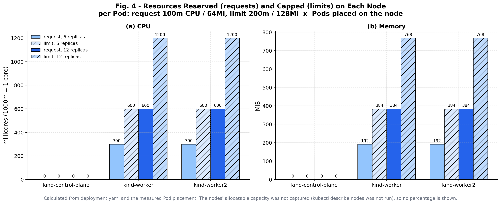</p>

**What the graph shows:**
- **CPU:** each worker had **300m requested at 6 replicas** and **600m at 12**. The limits are double: 600m and 1200m.
- **Memory:** **192 → 384 Mi** requested, and 384 → 768 Mi in limits.
- Requests are what the scheduler **subtracts from a node's allocatable capacity**. With 6 Pods per worker, 0.6 core is promised away on each worker, even if NGINX is idle and uses almost nothing.
- Limits can add up to **more than the node has** (overcommitment). That is allowed, because limits are caps, not reservations.
- The nodes' allocatable capacity was not captured, so the graph cannot say how close the workers were to full.

### 12.5 How fast new Pods were Running

<p align="center">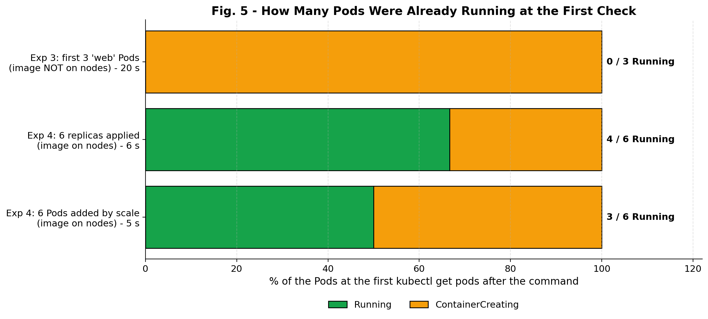</p>

**What the graph shows:** in Experiment 3, **0 of 3** Pods were Running after 20 s, because the image was still downloading. In this experiment **4 of 6** were Running after 6 s and **3 of 6** after 5 s, because the image was already cached on both workers. Start-up speed depends mostly on **whether the image is already on the node**, not on Kubernetes itself.

### 12.6 What was measured

<p align="center">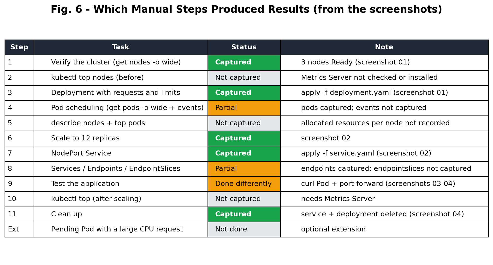</p>

This chart shows, honestly, which manual steps produced results (**green**), which were partial or done differently (**orange**) and which were **not captured** (grey). The data is strongest for **scheduling and the Service**. The **resource usage** parts (`kubectl top`, `describe nodes`) are missing.

### 12.7 Summary dashboard

<p align="center">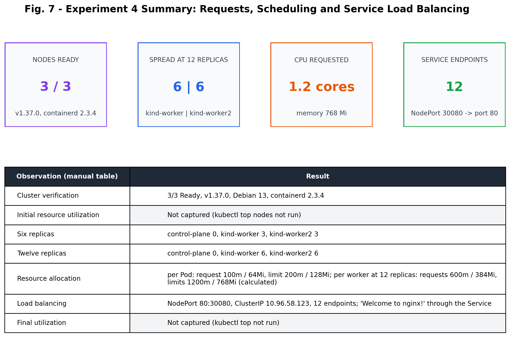</p>

---

## 13. Requests vs Limits vs Actual Usage — Comparison

The manual says: *"pod placement and actual CPU or memory usage are different measurements."* These three numbers are easy to confuse:

| | **Request** | **Limit** | **Actual usage** |
|:--|:--|:--|:--|
| Set by | The YAML (you) | The YAML (you) | The running application |
| Seen with | `kubectl describe nodes` → *Allocated resources* | `kubectl describe pod` | `kubectl top pods` / `top nodes` (needs Metrics Server) |
| Used for | **Scheduling**: does the Pod fit? | **Enforcement**: throttle CPU, kill on memory | Monitoring and autoscaling |
| Value here (per Pod) | 100m CPU, 64 Mi | 200m CPU, 128 Mi | **Not captured** |
| Value here (per worker, 12 replicas) | **600m, 384 Mi** (calculated) | 1200m, 768 Mi (calculated) | **Not captured** |
| Effect of an idle NGINX | Still reserved | Still the cap | Close to zero (expected) |

**Practical meaning:** requests that are too **high** waste capacity, because nodes look "full" while idle and new Pods stay `Pending`. Requests that are too **low** pack too many Pods onto a node, and they then compete for CPU. Good requests are based on **measured usage**, which is why Steps 2, 5 and 10 matter.

---

## 14. Observations and Limitations

**Observations:**

1. The cluster from Experiment 3 survived a week and a restart of Docker Desktop: all nodes were `Ready`, and the 6 `web` Pods came back by themselves (`RESTARTS 1`).
2. The scheduler split `resource-demo` **exactly evenly**: 3 + 3, then 6 + 6. The control plane received **no** application Pods.
3. With the image already on the nodes, new Pods were Running in **5–6 s**, compared with 97 s in Experiment 3.
4. Creating the Service needed **no Pod IPs**: the label selector found all **12 Pods** automatically.
5. The Service worked by **DNS name** from inside the cluster.
6. **Pod IPs are not stable.** After the restart, 3 of the 5 `web` Pods with a known earlier IP had a **different IP** than in Experiment 3 ([`web_pod_ip_changes.csv`](results/processed/web_pod_ip_changes.csv)). This is exactly why clients should use a Service instead of Pod IPs.

**Limitations:**

| Limitation | Effect | How to fix |
|:--|:--|:--|
| `kubectl top` (Steps 2, 5, 10) not run; Metrics Server not installed | No real CPU/memory usage, no before/after comparison | Install Metrics Server with `--kubelet-insecure-tls` (script below) |
| `kubectl describe nodes` not run | Node capacity and *Allocated resources* unknown; requests per node are **calculated**, not read from Kubernetes | Run Step 5 |
| Scheduling events and EndpointSlices not captured | The `Scheduled` reasons were not recorded | Run the Step 4 and Step 8 commands |
| NodePort not reachable from Windows (kind) | Step 9 done with an in-cluster curl Pod and port-forward | Add `extraPortMappings: containerPort 30080` to `kind-config.yaml` |
| Traffic distribution not measured | Load balancing shown by the 12 endpoints and one response, not by request counts | Run the request-count loop in Section 17.2 |
| Suggested extension (Pending Pod) not done | Resource-based scheduling *failure* not shown | Command in Section 17.2 |
| All nodes share one PC | "Free resources" of the nodes are really the same machine's | Expected with kind |

---

## 15. Troubleshooting and Issues Encountered

### 15.1 Issues seen during this experiment

| # | What was seen | Screenshot | Cause | Fix / meaning |
|:-:|:--|:-:|:--|:--|
| 1 | `ERROR: failed to create cluster: node(s) already exist for a cluster with the name "kind"` | 01 | The cluster from Experiment 3 still existed | Harmless. Skip `kind create cluster` when `kubectl get nodes` already shows the nodes |
| 2 | `web` Pods show `RESTARTS 1 (3m59s ago)` | 01 | Docker Desktop / the PC was restarted about 4 minutes before the session | Normal: the kubelet restarted every container. Their IPs changed |
| 3 | 2 Pods `ContainerCreating` 6 s after apply | 01 | Container still being created | Wait; they were Running at 25 s |
| 4 | `Warning: v1 Endpoints is deprecated in v1.33+; use discovery.k8s.io/v1 EndpointSlice` | 02 | The old Endpoints API is being replaced | Only a warning. Use `kubectl get endpointslices` |
| 5 | `couldn't attach to pod/test-curl, falling back to streaming logs` | 03 | `curl` finished before kubectl could attach | Harmless. The output was printed from the log, so the page appears twice |
| 6 | `http://NODE-IP:30080` not usable from Windows | — | kind node IPs are inside Docker's WSL 2 network, and port 30080 is not mapped to the host | Use a curl Pod, `kubectl port-forward`, or kind `extraPortMappings` |

### 15.2 General troubleshooting guide

| Problem | Solution |
|:--|:--|
| `error: Metrics API not available` on `kubectl top` | Install Metrics Server. On kind add `--kubelet-insecure-tls` to its arguments, then wait about a minute |
| A Pod stays `Pending` | `kubectl describe pod <name>`. *Insufficient cpu / memory* means the requests do not fit on any node |
| A Pod is `OOMKilled` | It used more memory than its limit. Raise `limits.memory` |
| The Service has no endpoints | The selector does not match the Pod labels, or the Pods are not Ready (`kubectl get pods --show-labels`) |
| `kubectl apply` reports a YAML error | Indentation: use spaces, not tabs; check `requests` / `limits` are under `resources` |
| `port-forward` stops | It runs only while the command is open. Restart it, and stop it with Ctrl+C |
| `provided port is already allocated` for nodePort 30080 | Another Service uses it. Pick another port in 30000–32767 |

---

## 16. Important Terms

| Term | Meaning |
|:--|:--|
| **Resource request** | CPU / memory reserved for a container; used by the scheduler |
| **Resource limit** | The maximum CPU / memory a container may use |
| **millicore (m)** | 1/1000 of a CPU core (100m = 0.1 core) |
| **Mi (mebibyte)** | 1,048,576 bytes |
| **Allocatable** | The part of a node's capacity available to Pods |
| **QoS class** | Guaranteed / Burstable / BestEffort, from requests and limits |
| **Throttling** | Slowing a container that tries to use more CPU than its limit |
| **OOMKilled** | A container stopped for using more memory than its limit |
| **Scheduler** | Filters and scores nodes and binds each Pod to one |
| **Taint** | A mark on a node that keeps Pods away unless they tolerate it |
| **Service** | A stable name and virtual IP in front of a set of Pods |
| **ClusterIP / NodePort** | Service IP inside the cluster / a port opened on every node |
| **Endpoints / EndpointSlice** | The Pod IP:port list behind a Service |
| **kube-proxy** | Node agent that routes Service connections to endpoints |
| **Label / selector** | Key-value tags on objects / the query that finds them |
| **port-forward** | kubectl tunnel from your PC to a Pod (or one Pod of a Service) |
| **Metrics Server** | The add-on that provides `kubectl top` data |
| **Overcommitment** | Total limits on a node larger than its capacity |

---

## 17. Conclusion and Future Work

### 17.1 Conclusion

The three-node kind cluster from Experiment 3 was used to study **resource allocation, scheduling and load balancing**.

- **Resource allocation:** each `resource-demo` Pod requested **100m CPU / 64 MiB** with limits of **200m / 128 MiB** (QoS **Burstable**). At 12 replicas, that reserved **600m CPU and 384 MiB on each worker** (**1.2 cores and 768 MiB** in total), with limits of twice that.
- **Scheduling:** the scheduler placed the Pods **3 + 3** at 6 replicas and **6 + 6** at 12, with **none on the control plane**. Requests, the control-plane taint and the default spreading rules give a balanced layout without any manual placement.
- **Load balancing:** the NodePort Service `nginx-service` found **all 12 Pods** through its label selector. A request to `http://nginx-service:80` returned the NGINX page. Clients use one stable name even though Pod IPs change (as seen after the restart).
- **Not captured:** actual CPU/memory usage (`kubectl top`), node capacity (`describe nodes`), scheduling events, EndpointSlices, a measured traffic spread and the Pending-Pod extension.

**Key lesson:** Kubernetes schedules by **what Pods ask for (requests)**, enforces **what they may use (limits)**, and hides changing Pods behind a **Service**. Real usage is a separate measurement, and it is needed to set requests well.

### 17.2 Future work: commands to complete the missing parts

All of these are collected in [`scripts/complete_missing_steps.ps1`](scripts/complete_missing_steps.ps1):

```powershell
# Metrics Server for kubectl top (kind needs --kubelet-insecure-tls)
kubectl apply -f https://github.com/kubernetes-sigs/metrics-server/releases/latest/download/components.yaml
kubectl patch deployment metrics-server -n kube-system --type=json `
  -p '[{"op":"add","path":"/spec/template/spec/containers/0/args/-","value":"--kubelet-insecure-tls"}]'

kubectl top nodes                                          # Steps 2 and 10
kubectl get events --sort-by=.metadata.creationTimestamp  # Step 4
kubectl describe nodes                                     # Step 5: Allocated resources
kubectl top pods                                           # Steps 5 and 10
kubectl get endpointslices -l kubernetes.io/service-name=nginx-service   # Step 8

# Step 9: measure HOW the Service spreads 120 requests (count log lines per Pod)
kubectl run lb-test --rm -i --restart=Never --image=curlimages/curl --command -- `
  sh -c 'for i in $(seq 1 120); do curl -s -o /dev/null http://nginx-service:80; done'
kubectl get pods -l app=resource-demo -o name | ForEach-Object { "$_ $((kubectl logs $_ | Select-String '"GET / HTTP').Count)" }

# Extension: a Pod that asks for more CPU than any node has -> Pending, "Insufficient cpu"
kubectl create deployment big-request --image=nginx
kubectl set resources deployment big-request --requests=cpu=64
kubectl describe pod -l app=big-request
```

---

## 18. Repository Structure and Reproduction

```text
CC_Experiment_4/
├── README.md                              ← this report
├── k8s/
│   ├── deployment.yaml                    ← resource-demo: 6 replicas, requests 100m/64Mi, limits 200m/128Mi
│   └── service.yaml                       ← nginx-service: NodePort 30080 -> 80
├── screenshots/                           ← 4 screenshots, renamed in execution order (01 … 04)
├── scripts/
│   ├── lab_commands.ps1                   ← the commands run in the lab, in order
│   ├── complete_missing_steps.ps1         ← Steps 2, 4-events, 5, 8-EndpointSlices, 9-spread, 10, extension
│   └── generate_graphs.py                 ← matplotlib graphs for this report
├── results/
│   ├── raw/                               ← command outputs transcribed from the screenshots
│   │   ├── 01_nodes_and_deployment_6.txt
│   │   ├── 02_scale_12_service_endpoints.txt
│   │   └── 03_service_test_and_cleanup.txt
│   └── processed/
│       ├── cluster_nodes.csv
│       ├── pod_snapshots.csv              ← every Pod at 6 and 12 replicas (node, IP, status)
│       ├── resource_spec.csv
│       ├── requested_resources_per_node.csv   ← calculated by generate_graphs.py
│       ├── service_endpoints.csv
│       ├── web_pod_ip_changes.csv
│       ├── observation_table.csv          ← the manual's observation table
│       └── step_status.csv
└── graphs/                                ← 7 generated figures
```

**Reproduce** (PowerShell, kind cluster from Experiment 3 running):

```powershell
kubectl get nodes -o wide
kubectl apply -f k8s/deployment.yaml
kubectl get pods -o wide
kubectl scale deployment resource-demo --replicas=12
kubectl get pods -o wide
kubectl apply -f k8s/service.yaml
kubectl get services
kubectl get endpoints nginx-service
kubectl run test-curl --rm -i --tty --image=curlimages/curl -- http://nginx-service:80
kubectl delete service nginx-service
kubectl delete deployment resource-demo
```

**Regenerate the graphs:**

```bash
pip install matplotlib pandas
python scripts/generate_graphs.py
```

---

## 19. References

1. The Kubernetes Authors, *Resource Management for Pods and Containers*. https://kubernetes.io/docs/concepts/configuration/manage-resources-containers/
2. The Kubernetes Authors, *Pod Quality of Service Classes*.
3. The Kubernetes Authors, *Kubernetes Scheduler* and *Scheduling Framework* (filtering and scoring).
4. The Kubernetes Authors, *Taints and Tolerations*.
5. The Kubernetes Authors, *Service*, *EndpointSlices* and *Virtual IPs and Service Proxies*.
6. kubernetes-sigs, *Metrics Server*. https://github.com/kubernetes-sigs/metrics-server
7. The Kubernetes Authors, *kind — Configuration: Extra Port Mappings*. https://kind.sigs.k8s.io/
8. B. Burns, J. Beda, K. Hightower and L. Evenson, *Kubernetes: Up and Running*, 3rd ed., O'Reilly, 2022.
9. *Kubernetes Practical Experiment — Analyze Resource Allocation, Scheduling, and Load Balancing in a Three-Node Cluster*, Cloud Computing Laboratory.

---

<div align="center"><sub>Experiment 4 · Cloud Computing Laboratory</sub></div>
