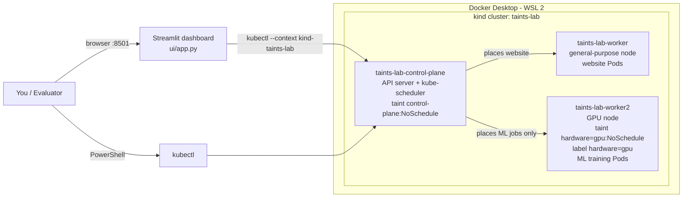

# Implementation Plan and Verified Run — Problem 07: Pod Scheduling Using Taints and Tolerations

**Course:** Cloud Computing Lab Evaluation 2 (26ECAC301, 5th semester) · **Problem:** 07 (slide 9)
**Scenario:** reserving an expensive **GPU node** for **ML training jobs**, while the company **website** stays on the general-purpose node.
**Machine:** Windows 11 laptop · AMD Ryzen 7 7435HS (8 cores / 16 threads) · 15.8 GB RAM
**Stack:** Docker Desktop (WSL 2, Engine 29.8.0) · kind v0.33.0 · Kubernetes v1.37.0 · kubectl v1.36.1 · `nginx:alpine` · `python:3.12-alpine` · Python 3.13 + Streamlit 1.56 (UI)

This file is the step-by-step plan **and** the record of what was verified on this laptop (Section 12).
Every command below was run here, and every "expected" result was checked against the measured output.

---

## 1. The problem statement (slide 9)

| Part | Text |
|---|---|
| **Problem Statement** | Configure taints on selected worker nodes and tolerations on application pods to control which workloads can be scheduled on those nodes. |
| **Implementation Approach** | Apply a taint to a worker node, deploy a pod without a matching toleration, then deploy another pod with the correct toleration and compare their scheduling outcomes. |
| **Why This Problem Matters** | Taints and tolerations help reserve nodes for specific workloads and prevent unsuitable workloads from being placed on them. |
| **What to Demonstrate / Measure** | Pod placement, scheduling events, taint effects and successful scheduling with matching tolerations. |

### 1.1 The realistic scenario used

A company runs a small cluster with two workers. One of them (`taints-lab-worker2`) is an **expensive GPU node**.
It must be **reserved for ML training jobs**; the company **website** must never take it.

| Role | Node / workload | Rule |
|---|---|---|
| General-purpose node | `taints-lab-worker` | no taint — open to everyone |
| **GPU node** | `taints-lab-worker2` | label `hardware=gpu` + taint **`hardware=gpu:NoSchedule`** |
| Ordinary workload | **`website`** (NGINX, 4 replicas) | **no toleration** → kept off the GPU node |
| Special workload | **`ml-training`** (Python, simulated training loop) | **toleration** `hardware=gpu` (+ **nodeSelector** `hardware=gpu`) → runs on the GPU node |

> **Honesty note:** kind nodes are Docker containers and have **no real GPU**. The GPU node is reserved purely by its
> taint and label — exactly how a real GPU node is reserved — and the ML job is a **simulated** training loop
> (prints epochs and loss). The scheduling behaviour being tested is real and unchanged.

### 1.2 Requirement → evidence map

| Slide requirement | Where it is shown |
|---|---|
| Pod placement | `kubectl get pods -o wide` (NODE column) in every step · Fig. 2, Fig. 3 · UI node cards |
| Scheduling events | `kubectl describe pod` → Events; `results/events.csv` (Scheduled, FailedScheduling, TaintManagerEviction) · Fig. 5 · UI events table |
| Taint effects | **NoSchedule** (S2–S6), **PreferNoSchedule** (S7), **NoExecute** (S8), and "NoSchedule does not evict running Pods" (S1b) · Fig. 4 |
| Successful scheduling with matching tolerations | S3 (allowed on the GPU node), S5 (only on the GPU node), S8 (`gpu-monitor` survives a NoExecute taint) |
| Compare Pods with and without toleration | S2 (website, none) vs S3 (ML, matching) vs S4 (ML, typo) · Fig. 2 · UI "Why is this Pod here?" tab |

---

## 2. Study of existing work

A web search found **tutorials and course labs** on this topic, but **no repository that matches this problem with a
kind multi-node cluster, a realistic workload story and a UI**:

- **Official reference:** Kubernetes documentation, *Taints and Tolerations* — taints act as a filter in the scheduler;
  `NoExecute` evicts running Pods; `tolerationSeconds` delays the eviction.
- **Course labs:** KodeKloud CKA "Taints and Tolerations", A Cloud Guru / Pluralsight "Scheduling Pods with Taints and
  Tolerations", LabEx tutorial — single cluster, terminal only.
- **Blogs:** GoLinuxCloud (NoSchedule + NoExecute demo), GeeksforGeeks (3-node kind cluster, add/remove a taint),
  OneUptime 2026 (workload isolation).
- **GitHub notes:** `omerbsezer/Fast-Kubernetes` (K8s-Taint-Toleration.md), simonangel-fong Note_Tech pages.

**What this project adds:** all three effects in one measured run; a wrong-toleration control (S4); the
"toleration allows but does not force" proof (S3 vs S5); a Pending → recovery case (S6); a soft-vs-hard contrast (S6 vs S7b);
measured eviction times (S8); CSVs and graphs; and a live UI that explains every placement.

**Design decisions from the study:**
- **kind** instead of Minikube: native multi-node clusters, and CC Experiment 3 already used it.
- **Bare Pods for NoExecute (S8)**, so an evicted Pod is not immediately re-created by a Deployment.
- A separate **cluster name** (`taints-lab`) and **namespace** (`gpu-lab`), so nothing else is touched.
- The ML containers **handle SIGTERM** (see Section 12.4 — found during the first run).

---

## 3. Storage, memory and safety

### 3.1 Before the experiment (measured 15 Nov 2026)

| Item | Measured | Needed | OK? |
|---|---|---|---|
| Free space on **C:** | **19.6 GB** | ≥ 6 GB | ✅ |
| Free space on D: | 182 GB | not used | — |
| Docker data file (`docker_data.vhdx`) | 9.77 GB (other projects' images + 5.17 GB build cache) | — | — |
| Laptop RAM | 15.8 GB total, 6.8 GB free | ≥ 3 GB free | ✅ |
| Docker Engine | 29.8.0 · 16 CPUs · 7.66 GiB memory (WSL default) | ≥ 4 GiB | ✅ |
| kind | **not installed** → installed v0.33.0 (user scope) | — | ✅ |
| kubectl | v1.36.1 (bundled with Docker Desktop) | ±1 minor of server v1.37 | ✅ |
| Python / Streamlit / pandas / matplotlib | 3.13.5 / 1.56.0 / 2.2.3 / 3.10.0 | — | ✅ |

### 3.2 After the experiment (measured, cluster still running)

| Item | Measured |
|---|---|
| Free space on C: | **15.8 GB** (−3.8 GB) |
| `docker_data.vhdx` | 13.36 GB (**+3.59 GB**) |
| `kindest/node:v1.37.0` image | 1.34 GB |
| Node volumes (each node's own `/var`, holding the Kubernetes system images) | +2.63 GB |
| Node container layers | < 5 MB |
| `nginx:alpine` / `python:3.12-alpine` inside each worker | 26.4 MB / 18.1 MB |
| `kind.exe` | 10.3 MB |
| Project folder (YAML, scripts, CSVs, graphs, transcripts) | ~1 MB |
| RAM used by the 3 nodes while idle | ~1.2 GB (685 + 312 + 227 MiB) |

> **Correction:** the earlier estimate of "~2–2.5 GB" was too low. The measured cost is **~3.6–3.8 GB**, because every
> kind node keeps its own copy of the Kubernetes system images in a volume. It is all removed with
> `kind delete cluster --name taints-lab` (Section 11).

### 3.3 Safety rules followed

- No change to Windows, BIOS, WSL or Docker settings. kind was installed with `winget --scope user` (no admin rights).
- No `docker system prune`; no other image, container or volume was touched (the `library-app` and postgres items are intact).
- Every command targets **only** the context `kind-taints-lab`. The runner stops if the node names are not the
  expected three; the UI cannot taint the control plane.
- Everything is reversible: one command deletes the whole cluster and frees its disk space.

---

## 4. Architecture



---

## 5. Folder structure

```text
CC_lab_evaluation_2/
├── README.md                              final report
├── Implementation.md                      this plan + verified run
├── DEMO_GUIDE.md                          plain-language dashboard guide + demo script
├── Cloud_Computing_Lab_Evaluation_2_Formatted.pptx   problem statements (slide 9 = Problem 07)
├── k8s/
│   ├── 00-kind-cluster.yaml               1 control plane + 2 workers
│   ├── 01-namespace.yaml                  namespace gpu-lab
│   ├── 02-website.yaml                    website, no toleration (S1, S2, S6, S7)
│   ├── 03-ml-training-toleration-only.yaml  S3
│   ├── 04-ml-training-wrong-toleration.yaml S4 (typo "gpus")
│   ├── 05-ml-training-dedicated.yaml      S5 toleration + nodeSelector
│   └── 06-gpu-fault-pods.yaml             S8 NoExecute test Pods
├── ui/
│   ├── app.py                             Streamlit dashboard
│   └── requirements.txt
├── scripts/
│   ├── run_experiment.py                  runs S1–S8 and records everything
│   └── generate_graphs.py                 Fig. 1–7 from the CSVs
├── results/
│   ├── raw/01–12_*.txt                    transcript of every step
│   ├── nodes.csv, placement.csv, placement_summary.csv
│   ├── events.csv, noexecute_timeline.csv, steps.csv
├── graphs/01–07_*.png
└── screenshots/                           your terminal + UI screenshots (Section 13)
```

---

## 6. Phase 0 — Prerequisites (one time)

```powershell
docker --version                       # Docker Desktop must be running
kubectl version --client               # v1.36.1
winget install --id Kubernetes.kind --version 0.33.0 --scope user
# close and reopen PowerShell, then:
kind version                           # kind v0.33.0 go1.26.7 windows/amd64
python -m pip install streamlit pandas matplotlib   # already installed on this laptop
```

If `kind` is "not recognized", reopen the terminal, or call it by its full path:
`%LOCALAPPDATA%\Microsoft\WinGet\Packages\Kubernetes.kind_Microsoft.Winget.Source_8wekyb3d8bbwe\kind.exe`

---

## 7. Phase 1 — Create the cluster

```powershell
cd C:\Users\Asus\Desktop\Cloud_computing\CC_PGC_labs\CC_github\CC_lab_evaluation_2
kind create cluster --name taints-lab --config k8s/00-kind-cluster.yaml
kubectl config current-context         # kind-taints-lab
kubectl get nodes -o wide              # 3 nodes Ready, v1.37.0
```
Verified: 431 s on the first run (almost all of it downloading the 1.34 GB node image). A re-creation reuses the
downloaded image and should be much faster, but that was not measured here.

---

## 8. Phase 2 — The built-in control-plane taint

```powershell
kubectl describe node taints-lab-control-plane | Select-String Taints
```
Verified output: `Taints: node-role.kubernetes.io/control-plane:NoSchedule`. The workers have no taints.
This is why application Pods never run on the control plane (also observed in CC Experiments 3 and 4).

---

## 9. Phase 3 — The scenarios (manual commands)

`python scripts/run_experiment.py` runs all of this automatically (~2 min 45 s once the images are cached).
For screenshots, run it by hand in this order. Delete each workload before the next one:
`kubectl delete deployment,pod -n gpu-lab --all`

| # | What | Commands | Verified result |
|---|---|---|---|
| **S1** | Website before the GPU node is reserved | `kubectl apply -f k8s/01-namespace.yaml -f k8s/02-website.yaml` · `kubectl get pods -n gpu-lab -o wide` | **2 general + 2 GPU node**, 0 control plane |
| **Reserve** | Label + taint the GPU node | `kubectl label nodes taints-lab-worker2 hardware=gpu` · `kubectl taint nodes taints-lab-worker2 hardware=gpu:NoSchedule` | **S1b:** the 2 website Pods already on the GPU node **keep running** — NoSchedule never evicts |
| **S2** | Website, no toleration | `kubectl apply -f k8s/02-website.yaml` | **4 general / 0 GPU** |
| **S3** | ML job, toleration only | `kubectl apply -f k8s/03-ml-training-toleration-only.yaml` | **2 general + 2 GPU** — allowed, not forced |
| **S4** | ML job, typo `gpus` | `kubectl apply -f k8s/04-ml-training-wrong-toleration.yaml` | **4 general / 0 GPU** — no match |
| **S5** | Dedicated: toleration + nodeSelector, next to the website | `kubectl apply -f k8s/02-website.yaml -f k8s/05-ml-training-dedicated.yaml` · `kubectl logs -n gpu-lab <ml-pod>` | **ML 3/3 on GPU; website 4/4 on general**; logs: `epoch 1 loss 2.4250 node taints-lab-worker2` |
| **S6** | General node in maintenance | `kubectl taint nodes taints-lab-worker maintenance=true:NoSchedule` · `kubectl apply -f k8s/02-website.yaml` · `kubectl describe pod -n gpu-lab <pod>` | **4 Pending**; event `FailedScheduling: 0/3 nodes are available: 3 node(s) had untolerated taint(s)` |
| S6b | Maintenance over | `kubectl taint nodes taints-lab-worker maintenance=true:NoSchedule-` | 4/4 scheduled and Ready **4.6 s** later, all on general |
| **S7** | Soft reservation | `kubectl taint nodes taints-lab-worker2 hardware=gpu:NoSchedule-` · `kubectl taint nodes taints-lab-worker2 hardware=gpu:PreferNoSchedule` · `kubectl apply -f k8s/02-website.yaml` | **4 general / 0 GPU** — GPU node avoided |
| S7b | Soft rule gives way | `kubectl taint nodes taints-lab-worker maintenance=true:NoSchedule` · `kubectl scale deployment/website -n gpu-lab --replicas=6` | **4 general + 2 GPU** — no other node, so the soft rule allows the GPU node (compare S6: hard rule → Pending) |
| — | Restore | remove `maintenance`, remove `PreferNoSchedule`, re-add `hardware=gpu:NoSchedule` | — |
| **S8** | GPU fault (NoExecute) | `kubectl apply -f k8s/06-gpu-fault-pods.yaml` · `kubectl taint nodes taints-lab-worker2 gpu-fault=true:NoExecute` · `kubectl get pods -n gpu-lab -w` | `ml-job-no-grace` evicted after **0.4 s**; `ml-job-grace-30s` after **31.0 s**; `gpu-monitor` **still running** after 60 s |
| — | Clean-up | `kubectl taint nodes taints-lab-worker2 gpu-fault-` · `kubectl taint nodes taints-lab-worker2 hardware-` · `kubectl label nodes taints-lab-worker2 hardware-` · `kubectl delete namespace gpu-lab` | Only the built-in control-plane taint remains |

**Key points to explain:**
1. A taint is on a **node**; a toleration is on a **Pod**. The scheduler only compares the two — it does not care what the app is.
2. A toleration **allows**, it does not **send** (S3). Taint **repels** + nodeSelector **attracts** = dedicated node (S5).
3. With `operator: Equal`, key **and** value **and** effect must match — one wrong letter fails (S4).
4. NoSchedule protects only **new** placements (S1b); NoExecute also removes **running** Pods (S8).
5. NoSchedule is **hard** (S6 → Pending); PreferNoSchedule is **soft** (S7b → uses the node when nothing else fits).

---

## 10. Phase 4 — The UI

```powershell
cd C:\Users\Asus\Desktop\Cloud_computing\CC_PGC_labs\CC_github\CC_lab_evaluation_2
python -m streamlit run ui/app.py          # open http://localhost:8501
```

| Part of the page | What it shows / does |
|---|---|
| Story banner + 4 metrics | Nodes, "GPU node reserved?", Pods placed, Pods Pending |
| 4 live cards (refresh every 3 s) | control plane · general node · GPU node · Pending — each with its taints (red NoSchedule, amber PreferNoSchedule, purple NoExecute), its `hardware` label and its Pods (blue website, purple ML) |
| Events table | latest Scheduled / FailedScheduling / TaintManagerEviction / Killing events |
| **Guided steps** tab | 1 Reserve GPU node · 2 Maintenance on · 3 Maintenance off · 4 GPU fault (NoExecute) · 5 GPU repaired · Reset |
| **Workloads** tab | Deploy / Delete for website, ML (toleration only), ML (typo), ML (dedicated), GPU-fault Pods — with the YAML of each |
| **Custom taint** tab | any key / value / effect on either worker (never the control plane) |
| **Why is this Pod here?** tab | for the chosen Pod, every node is marked ALLOWED / ALLOWED BUT AVOIDED / BLOCKED with the reason (which taint is or is not tolerated, whether the nodeSelector matches) |
| **Command log** tab | every kubectl command the page sent, with its output |

**Live demo order (about 5 min):** Reset → Deploy Website (spreads over both) → Step 1 Reserve GPU node (old Pods stay) →
Delete website, Deploy website (all on general) → Deploy ML toleration-only (both nodes) → "Why" tab on a website Pod and an ML Pod →
Delete ML, Deploy ML dedicated (GPU only) → Step 2 Maintenance, Delete + Deploy website (Pending) → Step 3 (recovers) →
Deploy GPU-fault Pods → Step 4 GPU fault (evictions in the events table) → Step 5 → Reset.

Verified (Streamlit AppTest against the live cluster): the page renders with no exceptions; metrics `3 / yes / 7 / 0`
in the S5 state; the "Why" tab shows `hardware=gpu:NoSchedule is NOT tolerated` for a website Pod and ALLOWED/BLOCKED
for an ML Pod; Guided step 2 added `maintenance:NoSchedule` to the general node (all 7 running Pods stayed) and step 3 removed it.

---

## 11. Phase 5 — Results, graphs, report, shut-down

```powershell
python scripts/run_experiment.py       # S1–S8, writes results/raw/*.txt and results/*.csv
python scripts/generate_graphs.py      # writes graphs/01–07 and results/placement_summary.csv
```

**After the evaluation — free the disk space (~3.6 GB):**
```powershell
kind delete cluster --name taints-lab
```
Note: the `.vhdx` file does not shrink by itself after the cluster is deleted; the space is reused by Docker.
Returning it to Windows needs Docker Desktop's disk-reclaim option or a manual compaction — not tested here, so it is not recommended without a backup.

---

## 12. Verified run on this laptop

### 12.1 Run details

| Item | Value |
|---|---|
| Cluster created | 15 Nov 2026, 431.2 s (first run, includes the 1.34 GB image download) |
| Final measured run | 15 Nov 2026, 18:33:52 – 18:36:35 UTC (16 Nov 00:03 – 00:06 IST), exit code 0 |
| Nodes | 3 × Debian 13 (trixie), kernel 6.6.87.2-microsoft-standard-WSL2, containerd 2.3.4, kubelet v1.37.0, 16 CPU / 7.66 GiB each (shared) |
| Node IPs | control plane 172.18.0.4 · worker 172.18.0.2 · worker2 172.18.0.3 |
| Pods created | 36 (S1 4 · S2 4 · S3 4 · S4 4 · S5 7 · S6 4 · S7 6 · S8 3) — 36 `Scheduled` events |

### 12.2 Placement (from `results/placement_summary.csv`)

| Snapshot | Workload | Control plane | General node | GPU node | Pending | Expected? |
|---|---|---:|---:|---:|---:|:-:|
| S1 no taint yet | website | 0 | 2 | 2 | 0 | ✅ |
| S1b 15 s after GPU taint | website | 0 | 2 | 2 | 0 | ✅ old Pods stay |
| S2 no toleration | website | 0 | 4 | 0 | 0 | ✅ |
| S3 toleration only | ml-training | 0 | 2 | 2 | 0 | ✅ |
| S4 wrong toleration | ml-training-typo | 0 | 4 | 0 | 0 | ✅ |
| S5 dedicated | ml-training | 0 | 0 | 3 | 0 | ✅ |
| S5 dedicated | website | 0 | 4 | 0 | 0 | ✅ |
| S6 maintenance + GPU hard taint | website | 0 | 0 | 0 | **4** | ✅ |
| S6b maintenance over | website | 0 | 4 | 0 | 0 | ✅ (4.6 s) |
| S7 soft: GPU avoided | website | 0 | 4 | 0 | 0 | ✅ |
| S7b soft: no other node | website | 0 | 4 | 2 | 0 | ✅ |
| S8 before the fault | gpu-fault-test | 0 | 0 | 3 | 0 | ✅ |

**12 of 12 snapshots matched the expected outcome.**

### 12.3 Events and NoExecute timing

- `FailedScheduling` × 4 (the 4 Pending website Pods in S6):
  `0/3 nodes are available: 3 node(s) had untolerated taint(s). preemption: 0/3 nodes are available: 3 Preemption is not helpful for scheduling.`
- `TaintManagerEviction` × 2: `Marking for deletion Pod gpu-lab/ml-job-no-grace` (18:35:25) and `.../ml-job-grace-30s` (18:35:55) — exactly 30 s apart.

| Pod | Toleration | Marked for deletion | Gone |
|---|---|---:|---:|
| ml-job-no-grace | only `hardware=gpu:NoSchedule` | 0.4 s | 1.5 s |
| ml-job-grace-30s | `gpu-fault=true:NoExecute`, `tolerationSeconds: 30` | 31.0 s | 32.2 s |
| gpu-monitor | `gpu-fault:NoExecute` (`Exists`), no time limit | not evicted | still running at 60.3 s |

### 12.4 Problems found during the work, and fixes

| # | Problem | Cause | Fix |
|---|---|---|---|
| 1 | `kind` not recognized after install | the new PATH is only read by new terminals | reopen PowerShell or use the full path (Section 6) |
| 2 | First GPU run: `ml-job-no-grace` **marked after 0.4 s but gone only after 32.8 s**; `ml-job-grace-30s` gone after 62.5 s | the Python process (PID 1 in the container) **ignored SIGTERM**, so Kubernetes waited the default 30 s grace period and then force-killed it | the ML containers now catch SIGTERM ("saving checkpoint") and exit → gone after 1.5 s / 32.2 s. Real ML jobs should do the same |
| 3 | Event `count` = 2 for each eviction | Kubernetes aggregates identical events; the Pod names were reused from the run 4 minutes earlier | Fig. 5 counts one event per Pod and reason, seen during this run (gives the true 2) |
| 4 | Headless browser screenshots of the UI came out blank | Streamlit draws the page through a live WebSocket after loading | UI screenshots are taken by hand (Section 13); the UI itself was verified with Streamlit AppTest |
| 5 | Disk estimate too low (2–2.5 GB) | each node stores its own Kubernetes system images | measured 3.6–3.8 GB; recorded in Section 3.2 |
| 6 | An earlier run (NGINX-only version) was replaced | the scenario was changed to the GPU-node story for realism | its results were deleted; only the GPU-node run is kept |

---

## 13. Screenshots to take (for the README)

Save them in `screenshots/` with these names:

| File | Show |
|---|---|
| `01_cluster_nodes.png` | `kind get clusters` + `kubectl get nodes -o wide` |
| `02_builtin_taint.png` | `kubectl describe node taints-lab-control-plane \| Select-String Taints` |
| `03_reserve_gpu_node.png` | label + taint commands and the taints table |
| `04_S2_website_no_toleration.png` | `kubectl get pods -n gpu-lab -o wide` (all on worker) |
| `05_S3_ml_toleration_only.png` | ML Pods on both workers |
| `06_S5_dedicated.png` | website on worker, ML on worker2 + `kubectl logs` |
| `07_S6_pending_events.png` | Pending Pods + `kubectl describe pod` Events (FailedScheduling) |
| `08_S8_noexecute.png` | `kubectl get pods -n gpu-lab -w` during the GPU fault |
| `09_ui_overview.png` | the dashboard in the S5 state |
| `10_ui_why_tab.png` | the "Why is this Pod here?" tab for a website Pod |
| `11_ui_pending.png` | the dashboard during S6 (Pending card filled) |
