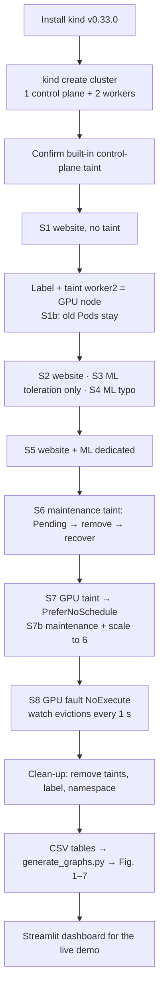
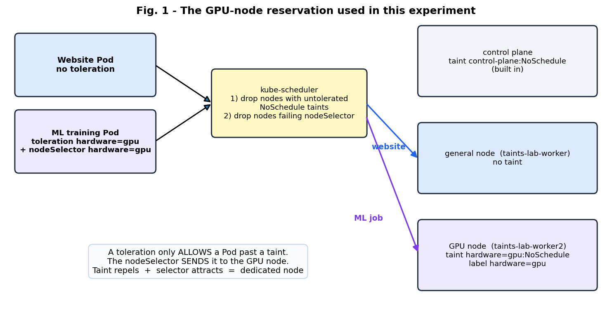
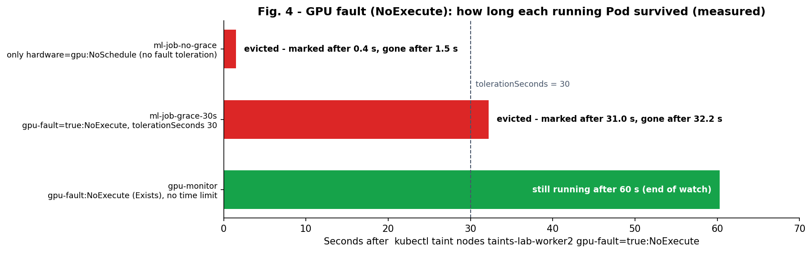
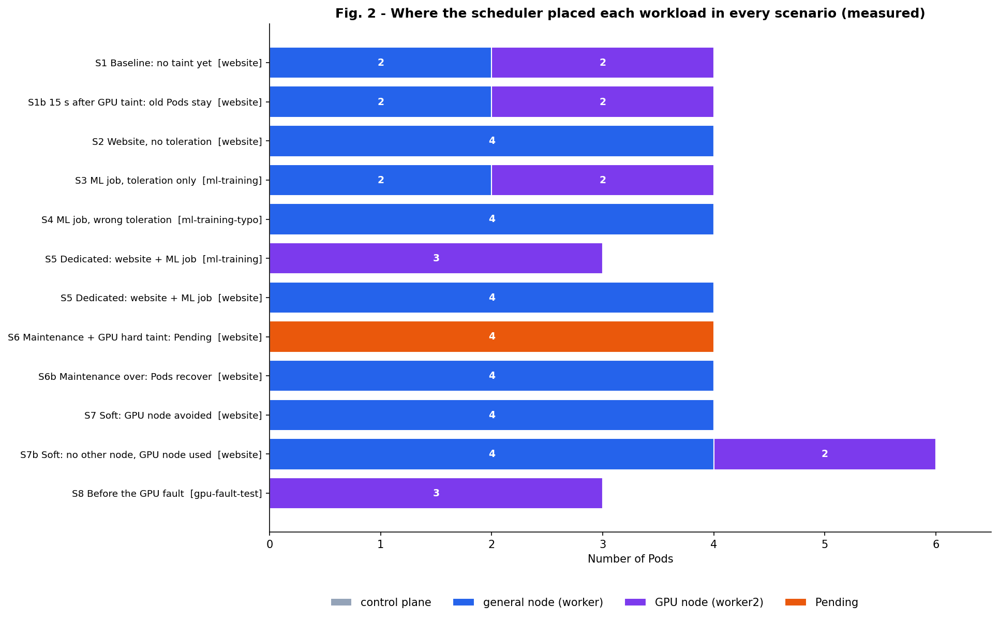
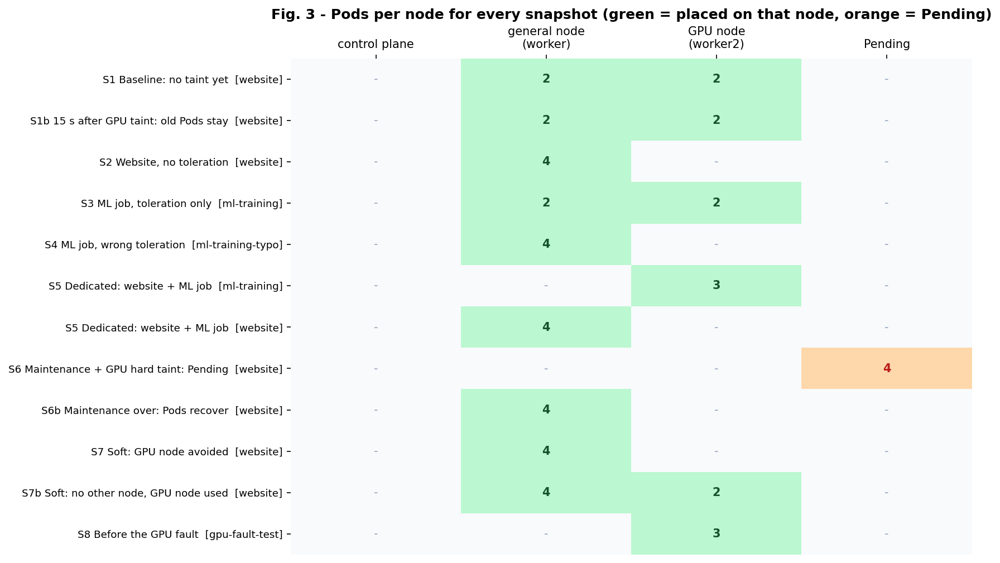
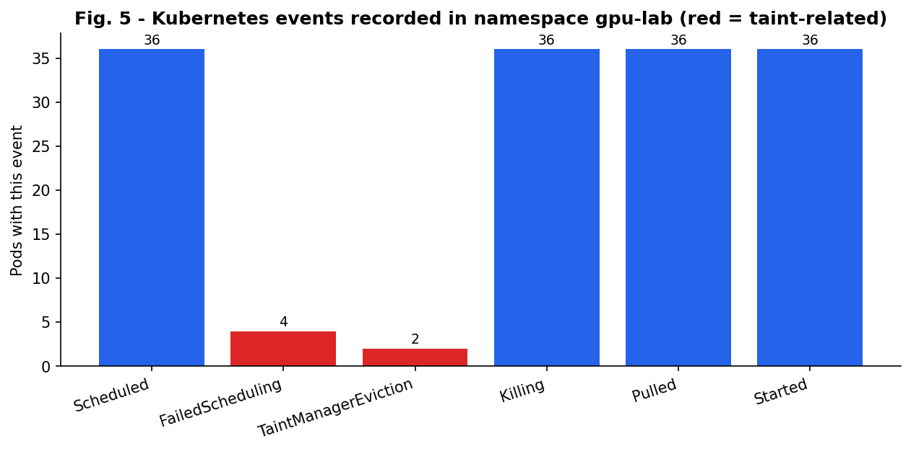
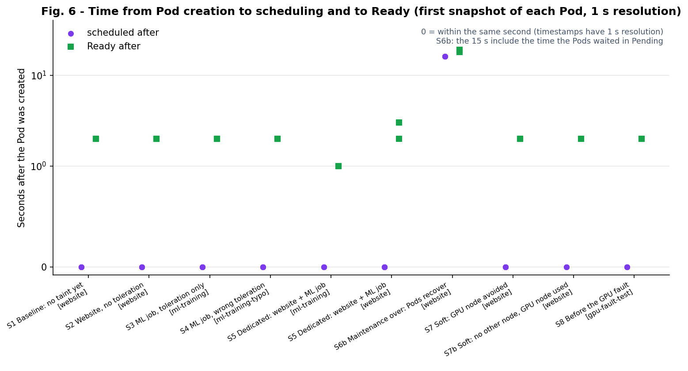
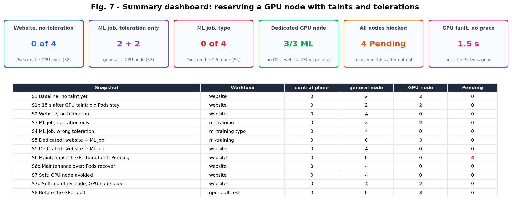

<div align="center">

# Lab Evaluation 2 — Problem 07: Pod Scheduling Using Taints and Tolerations

### Reserving a GPU Node for ML Jobs on a Three-Node Kubernetes Cluster · NoSchedule · PreferNoSchedule · NoExecute · Live Dashboard

**Course:** Cloud Computing Laboratory (26ECAC301, 5th semester) — Lab Evaluation 2, Problem 07
**Tools:** Docker Desktop (WSL 2) · kind v0.33.0 · Kubernetes v1.37.0 · kubectl v1.36.1 · NGINX · Python 3.12 · Streamlit
**Platform:** Windows 11 laptop · AMD Ryzen 7 7435HS · 15.8 GB RAM · each Kubernetes node runs as a Docker container


</div>

---

## Abstract

Kubernetes normally places a Pod on **any** node that has room. Sometimes that is wrong: an expensive **GPU node** should run
**ML training jobs**, not an ordinary website. Kubernetes solves this with **taints** (a "keep out" mark on a node) and
**tolerations** (a matching permission on a Pod).

In this project a three-node cluster was built with kind. The worker `taints-lab-worker2` played the role of a **GPU node**
and was reserved with the taint `hardware=gpu:NoSchedule` and the label `hardware=gpu`. A **website** (NGINX, no toleration)
and a simulated **ML training job** (Python, with a toleration) were then deployed in eight scenarios. All results below
were measured in one automated run (`scripts/run_experiment.py`, 2 min 43 s, 36 Pods):

- **Without a toleration**, the website was kept off the GPU node: **4 / 4 Pods on the general node, 0 on the GPU node**.
- **With a matching toleration only**, the ML job was **allowed** on the GPU node but not sent there: **2 + 2**.
- **A one-letter typo** in the toleration (`gpus`) blocked the ML job again: **0 / 4 on the GPU node**.
- **Toleration + nodeSelector** made the GPU node **dedicated**: **ML 3 / 3 on the GPU node, website 4 / 4 on the general node**.
- **When every node was tainted**, the website stayed **Pending** with `FailedScheduling … 3 node(s) had untolerated taint(s)`,
  and recovered **4.6 s** after the taint was removed.
- **PreferNoSchedule** is soft: the GPU node was avoided (4 / 0), but used when nothing else was free (**4 + 2**).
- **NoExecute** (a simulated GPU fault) evicted a running job after **0.4 s**, a job with `tolerationSeconds: 30` after
  **31.0 s**, and left a monitoring agent with an unlimited toleration **running**.

**12 of 12 placement snapshots matched the expected outcome.** A Streamlit dashboard shows the nodes, taints, Pods and
events live and explains *why* each Pod may or may not use each node.

---

## Table of Contents

1. [Introduction](#1-introduction)
2. [Problem Statement and Objectives](#2-problem-statement-and-objectives)
3. [Basic Concepts](#3-basic-concepts)
4. [Experimental Setup](#4-experimental-setup)
5. [Scenario Design](#5-scenario-design)
6. [Methodology and Workflow](#6-methodology-and-workflow)
7. [Part A — Cluster and the Built-in Taint](#7-part-a--cluster-and-the-built-in-taint)
8. [Part B — NoSchedule: With and Without Tolerations (S1–S5)](#8-part-b--noschedule-with-and-without-tolerations-s1s5)
9. [Part C — No Node Left: Pending and Recovery (S6)](#9-part-c--no-node-left-pending-and-recovery-s6)
10. [Part D — PreferNoSchedule: a Soft Reservation (S7)](#10-part-d--prefernoschedule-a-soft-reservation-s7)
11. [Part E — NoExecute: a GPU Fault (S8)](#11-part-e--noexecute-a-gpu-fault-s8)
12. [The Dashboard UI](#12-the-dashboard-ui)
13. [Consolidated Results](#13-consolidated-results)
14. [Analysis](#14-analysis)
15. [Observations and Limitations](#15-observations-and-limitations)
16. [Troubleshooting and Issues Encountered](#16-troubleshooting-and-issues-encountered)
17. [Important Terms](#17-important-terms)
18. [Conclusion](#18-conclusion)
19. [How to Run This Project (Prerequisites and Full Procedure)](#19-how-to-run-this-project-prerequisites-and-full-procedure)
20. [Repository Structure](#20-repository-structure)
21. [References](#21-references)

> **New to Kubernetes?** Read [`DEMO_GUIDE.md`](DEMO_GUIDE.md) — a plain-language guide to the dashboard and a click-by-click demo script.

---

## 1. Introduction

A Kubernetes **cluster** is a group of machines (**nodes**). The **control plane** manages the cluster; **worker** nodes run
the applications. Applications run in **Pods** — a Pod is a wrapper around one container — and a **Deployment** keeps a
chosen number of identical Pods (replicas) running.

When a new Pod is created, the **kube-scheduler** chooses its node. By default it picks any node with enough free CPU and
memory. Real clusters, however, are not uniform: some nodes have GPUs, more memory or special licences, and some are
being repaired. Administrators need a way to say *"only these workloads may use this node"*.

**Taints and tolerations** provide exactly that. A taint on a node keeps Pods away; a toleration on a Pod lets that Pod
past one specific taint. This report builds that mechanism on a laptop, measures how the scheduler reacts in eight
scenarios, and shows the result in a live dashboard.

CC Experiments 3 and 4 already showed one taint at work without naming it: no application Pod ever ran on the control
plane. Here that built-in taint is confirmed, and new taints are created and controlled directly.

---

## 2. Problem Statement and Objectives

**Problem Statement (slide 9):** *Configure taints on selected worker nodes and tolerations on application pods to control
which workloads can be scheduled on those nodes.*

**Implementation Approach:** *Apply a taint to a worker node, deploy a pod without a matching toleration, then deploy
another pod with the correct toleration and compare their scheduling outcomes.*

**What to Demonstrate / Measure:** *Pod placement, scheduling events, taint effects and successful scheduling with matching tolerations.*

| Required | Where in this report |
|---|---|
| Pod placement | §8–§11, §13 (Fig. 2, Fig. 3) |
| Scheduling events | §9, §11, §13 (Fig. 5), `results/events.csv` |
| Taint effects | NoSchedule §8–§9 · PreferNoSchedule §10 · NoExecute §11 (Fig. 4) |
| Successful scheduling with matching tolerations | S3, S5 (§8), `gpu-monitor` (§11) |
| Pod without vs with toleration | S2 vs S3 vs S4 (§8) |

**Objectives**

1. Build a 3-node cluster and confirm the control plane's built-in taint.
2. Reserve one worker as a GPU node with a taint and a label.
3. Compare Pods without a toleration, with a matching toleration and with a wrong one.
4. Make the GPU node dedicated with toleration + nodeSelector.
5. Show all three taint effects, including eviction of running Pods.
6. Record placement, events and timings as CSV files and graphs, and build a dashboard that explains each decision.

---

## 3. Basic Concepts

### 3.1 Taint and toleration

| | Put on | Form | Meaning |
|---|---|---|---|
| **Taint** | a node | `key=value:effect` | "Pods may not use this node unless they tolerate this mark" |
| **Toleration** | a Pod | key, operator, value, effect | "this Pod accepts that mark" |

```yaml
# Taint (command):   kubectl taint nodes taints-lab-worker2 hardware=gpu:NoSchedule
# Toleration (in the Pod template):
tolerations:
- key: "hardware"
  operator: "Equal"      # Equal: key, value and effect must all match. Exists: key (and effect) only.
  value: "gpu"
  effect: "NoSchedule"
```

### 3.2 The three effects

| Effect | New Pods without the toleration | Pods already running |
|---|---|---|
| `NoSchedule` | never placed here | **stay** |
| `PreferNoSchedule` | placed here only if no better node exists | stay |
| `NoExecute` | never placed here | **evicted** (at once, or after `tolerationSeconds`) |

### 3.3 Toleration vs nodeSelector

A toleration **removes a barrier**; it does not choose a node. A **nodeSelector** (or node affinity) **chooses** nodes by
their labels. A dedicated node therefore needs both:

| | Effect on the GPU node |
|---|---|
| Taint on the node | repels every Pod without a toleration |
| Toleration on the Pod | lets this Pod past the taint |
| nodeSelector on the Pod | sends this Pod only to nodes labelled `hardware=gpu` |

### 3.4 How the scheduler uses taints

The scheduler first **filters** nodes (a node with a `NoSchedule` or `NoExecute` taint the Pod does not tolerate is removed;
so is a node that fails the nodeSelector) and then **scores** the rest (untolerated `PreferNoSchedule` taints lower the score).
If no node survives the filter, the Pod stays **Pending** and a `FailedScheduling` event explains why.

---

## 4. Experimental Setup

| Item | Value |
|---|---|
| Laptop | Windows 11 · AMD Ryzen 7 7435HS (8 cores / 16 threads) · 15.8 GB RAM |
| Docker | Docker Desktop, WSL 2 backend, Engine 29.8.0 · 16 CPUs · 7.66 GiB available to containers |
| kind | v0.33.0 (installed with `winget --scope user`) |
| Kubernetes | v1.37.0 (node image `kindest/node:v1.37.0`) · kubectl client v1.36.1 |
| Nodes | 3 × Debian 13 (trixie), kernel 6.6.87.2-microsoft-standard-WSL2, containerd 2.3.4 |
| Node roles | `taints-lab-control-plane` (manager) · `taints-lab-worker` (general-purpose, 172.18.0.2) · `taints-lab-worker2` (**GPU node**, 172.18.0.3) |
| Workload images | `nginx:alpine` (26.4 MB) · `python:3.12-alpine` (18.1 MB) |
| UI | Python 3.13.5 · Streamlit 1.56.0 · pandas 2.2.3 |
| Graphs | matplotlib 3.10.0 |
| Run date | 15 Nov 2026, 18:33:52 – 18:36:35 UTC (16 Nov 00:03 – 00:06 IST) |

**Disk and memory (measured):** the cluster added **~3.6 GB** to Docker's disk (1.34 GB node image + 2.63 GB node
volumes) and uses **~1.2 GB RAM** when idle. `kind delete cluster --name taints-lab` removes it.

> **Note on the GPU:** kind nodes are containers and have **no real GPU**. The "GPU node" is reserved exactly as a real
> one would be — by its taint and label — and the ML job is a **simulated** training loop that prints epochs and loss.
> The scheduling behaviour under test is real.

---

## 5. Scenario Design

| Workload | File | Replicas | Toleration | nodeSelector |
|---|---|---:|---|---|
| `website` (NGINX) | `k8s/02-website.yaml` | 4 | none | none |
| `ml-training` (toleration only) | `k8s/03-ml-training-toleration-only.yaml` | 4 | `hardware=gpu:NoSchedule` | none |
| `ml-training-typo` | `k8s/04-ml-training-wrong-toleration.yaml` | 4 | `hardware=`**`gpus`**`:NoSchedule` | none |
| `ml-training` (dedicated) | `k8s/05-ml-training-dedicated.yaml` | 3 | `hardware=gpu:NoSchedule` | `hardware=gpu` |
| `ml-job-no-grace` (Pod) | `k8s/06-gpu-fault-pods.yaml` | 1 | GPU taint only | `hardware=gpu` |
| `ml-job-grace-30s` (Pod) | same | 1 | + `gpu-fault=true:NoExecute`, 30 s | `hardware=gpu` |
| `gpu-monitor` (Pod) | same | 1 | + `gpu-fault:NoExecute` (Exists), no limit | `hardware=gpu` |

| # | Scenario | Taints on the workers | Question it answers |
|---|---|---|---|
| S1 / S1b | website before / after reserving the GPU node | none → `hardware=gpu:NoSchedule` on GPU | Does adding NoSchedule move running Pods? |
| S2 | website | GPU: NoSchedule | Is a Pod without a toleration kept out? |
| S3 | ML, toleration only | GPU: NoSchedule | Does a toleration send the Pod to the node? |
| S4 | ML, typo | GPU: NoSchedule | Must the toleration match exactly? |
| S5 | website + ML dedicated | GPU: NoSchedule | How is a node made truly dedicated? |
| S6 / S6b | website | + general: `maintenance=true:NoSchedule`, then removed | What happens when no node is allowed? |
| S7 / S7b | website (4 → 6) | GPU: `PreferNoSchedule`; then general: maintenance | How does a soft taint differ from a hard one? |
| S8 | three bare Pods | GPU: + `gpu-fault=true:NoExecute` | How are running Pods evicted? |

All Pods request 10–20 m CPU and 16–32 MiB memory, so resources never limit placement — only taints and selectors do.
Each scenario is deleted before the next one, so the snapshots do not influence each other.

---

## 6. Methodology and Workflow



`scripts/run_experiment.py` runs every step with `kubectl --context kind-taints-lab`, waits until the Pods are scheduled
and Ready, records a **snapshot** (each Pod's node, phase, tolerations and nodeSelector), collects the namespace events,
and writes a terminal-style transcript of every command to `results/raw/`. It refuses to run if the cluster's node names
are not the expected three.

<p align="center"></p>

---

## 7. Part A — Cluster and the Built-in Taint

```powershell
kind create cluster --name taints-lab --config k8s/00-kind-cluster.yaml
kubectl get nodes -o wide
kubectl describe node taints-lab-control-plane | Select-String Taints
```

Measured (`results/raw/01_…`, `02_…`):

```text
✓ Joining worker nodes 🚜
• Ready after 7s 💚
ELAPSED_SECONDS=431.2                     (includes the 1.34 GB node-image download)

NAME                       STATUS   ROLES           VERSION   INTERNAL-IP   CONTAINER-RUNTIME
taints-lab-control-plane   Ready    control-plane   v1.37.0   172.18.0.4    containerd://2.3.4
taints-lab-worker          Ready    <none>          v1.37.0   172.18.0.2    containerd://2.3.4
taints-lab-worker2         Ready    <none>          v1.37.0   172.18.0.3    containerd://2.3.4

Taints:             node-role.kubernetes.io/control-plane:NoSchedule
```

The control plane carries a **NoSchedule taint from the start**; the workers carry none. This is why application Pods
never ran on the control plane in CC Experiments 3 and 4, and why it holds 0 Pods in every scenario here.

---

## 8. Part B — NoSchedule: With and Without Tolerations (S1–S5)

### 8.1 S1 → S1b: reserving the GPU node does not move running Pods

```powershell
kubectl apply -f k8s/01-namespace.yaml -f k8s/02-website.yaml        # S1
kubectl label nodes taints-lab-worker2 hardware=gpu
kubectl taint nodes taints-lab-worker2 hardware=gpu:NoSchedule        # reserve the GPU node
```

```text
NODE                       TAINT-KEYS                              VALUES   EFFECTS      HARDWARE-LABEL
taints-lab-control-plane   node-role.kubernetes.io/control-plane   <none>   NoSchedule   <none>
taints-lab-worker          <none>                                  <none>   <none>       <none>
taints-lab-worker2         hardware                                gpu      NoSchedule   gpu
```

| Snapshot | General node | GPU node |
|---|---:|---:|
| S1 website, before the taint | 2 | 2 |
| S1b website, 15 s after the taint | 2 | 2 |

The two website Pods already on the GPU node **kept running**: `NoSchedule` only affects **future** placements.

### 8.2 S2 — website without a toleration

```text
NAME                       READY   STATUS    NODE
website-…                  1/1     Running   taints-lab-worker      (× 4)
```
**4 / 4 on the general node, 0 on the GPU node.** The GPU node was filtered out because the website does not tolerate `hardware=gpu:NoSchedule`.

### 8.3 S3 — ML job with a matching toleration only

**2 on the general node + 2 on the GPU node.** The toleration made the GPU node *eligible*, but nothing *required* it,
so the scheduler spread the replicas over both workers. `kubectl describe pod` shows:
`Tolerations: hardware=gpu:NoSchedule` and `Node-Selectors: <none>`.

### 8.4 S4 — ML job with a typo (`gpus`)

**4 / 4 on the general node, 0 on the GPU node.** With `operator: Equal`, the value must match exactly; `gpus ≠ gpu`, so
the toleration does not apply and the job is treated like any Pod without one.

### 8.5 S5 — dedicated GPU node (toleration + nodeSelector)

```text
ml-training-…   Running   taints-lab-worker2     (× 3)
website-…       Running   taints-lab-worker      (× 4)

PS> kubectl logs -n gpu-lab ml-training-764dbccb48-9gkx8 --tail=3
[simulated] ML training job started on node taints-lab-worker2
epoch     1  loss 2.4250  node taints-lab-worker2
epoch     2  loss 2.3522  node taints-lab-worker2
```
**ML 3 / 3 on the GPU node; website 4 / 4 on the general node** — the intended final layout. The taint keeps the website
out; the nodeSelector keeps the ML job in.

---

## 9. Part C — No Node Left: Pending and Recovery (S6)

The general node is put into maintenance, so **every** node now has a hard taint the website does not tolerate:

```powershell
kubectl taint nodes taints-lab-worker maintenance=true:NoSchedule
kubectl apply -f k8s/02-website.yaml
kubectl describe pod -n gpu-lab <website-pod>
```

```text
Events:
  Type     Reason            Age   From               Message
  Warning  FailedScheduling  15s   default-scheduler  0/3 nodes are available: 3 node(s) had untolerated taint(s).
                                                      preemption: 0/3 nodes are available: 3 Preemption is not helpful for scheduling.
```

All **4 website Pods stayed Pending**. The three untolerated taints were `control-plane:NoSchedule`, `maintenance=true:NoSchedule`
and `hardware=gpu:NoSchedule`. After `kubectl taint nodes taints-lab-worker maintenance=true:NoSchedule-`, all 4 were
scheduled on the general node and Ready **4.6 s** later — no manual restart was needed.

---

## 10. Part D — PreferNoSchedule: a Soft Reservation (S7)

The GPU taint is changed from hard to soft:

```powershell
kubectl taint nodes taints-lab-worker2 hardware=gpu:NoSchedule-
kubectl taint nodes taints-lab-worker2 hardware=gpu:PreferNoSchedule
kubectl apply -f k8s/02-website.yaml                                       # S7
kubectl taint nodes taints-lab-worker maintenance=true:NoSchedule
kubectl scale deployment/website -n gpu-lab --replicas=6                    # S7b
```

| Snapshot | General node | GPU node | Pending |
|---|---:|---:|---:|
| S7 — both nodes usable | 4 | 0 | 0 |
| S7b — general node in maintenance, 2 new replicas | 4 | **2** | 0 |
| *compare S6 — same situation with the hard taint* | 0 | 0 | **4** |

With a soft taint, the scheduler **avoided** the GPU node while it had a choice (S7), but **used** it when no other node was
available (S7b). With the hard taint, the same situation left the Pods Pending (S6).

---

## 11. Part E — NoExecute: a GPU Fault (S8)

Three Pods run on the GPU node; then the node "fails" and the administrator drains it:

```powershell
kubectl apply -f k8s/06-gpu-fault-pods.yaml
kubectl taint nodes taints-lab-worker2 gpu-fault=true:NoExecute
```

| Pod | Toleration for `gpu-fault` | Marked for deletion | Gone |
|---|---|---:|---:|
| `ml-job-no-grace` | none | **0.4 s** | 1.5 s |
| `ml-job-grace-30s` | `NoExecute`, `tolerationSeconds: 30` | **31.0 s** | 32.2 s |
| `gpu-monitor` | `NoExecute`, `Exists`, no time limit | not evicted | **still running** at 60.3 s |

Events: `TaintManagerEviction — Marking for deletion Pod gpu-lab/ml-job-no-grace` (18:35:25) and
`… ml-job-grace-30s` (18:35:55), **exactly 30 s apart**. "Gone" is about 1 s after "marked" because each container
catches the stop signal (SIGTERM) and exits at once (see §16, issue 2).

<p align="center"></p>

**What the graph shows:** each bar is how long a running Pod survived after the NoExecute taint. Without a toleration the
job was removed almost immediately; with `tolerationSeconds: 30` it got a 30-second window (enough to save a checkpoint);
the monitoring agent, which must stay to report the fault, was never removed.

---

## 12. The Dashboard UI

```powershell
python -m streamlit run ui/app.py        # http://localhost:8501
```

| Part | Purpose |
|---|---|
| Story banner and 4 metrics | Nodes · "GPU node reserved?" · Pods placed · Pods Pending |
| 4 live cards (refresh every 3 s) | control plane, general node, GPU node and **Pending** — each with its taints (red NoSchedule, amber PreferNoSchedule, purple NoExecute), its `hardware` label and its Pods (blue website, purple ML) |
| Events table | Scheduled / FailedScheduling / TaintManagerEviction / Killing |
| **Guided steps** | Reserve GPU node · Maintenance on/off · GPU fault (NoExecute) · GPU repaired · Reset |
| **Workloads** | Deploy / Delete each YAML, with the YAML shown |
| **Custom taint** | any key / value / effect on either worker (the control plane is excluded) |
| **Why is this Pod here?** | for a chosen Pod, each node is marked **ALLOWED / ALLOWED BUT AVOIDED / BLOCKED** with the reasons (which taint is tolerated, whether the nodeSelector matches), using the same matching rules as the scheduler |
| **Command log** | every kubectl command sent by the page and its output |

Verified with Streamlit AppTest against the live cluster (S5 state): no exceptions; metrics `3 / yes / 7 / 0`; the "Why"
tab reports `hardware=gpu:NoSchedule is NOT tolerated` for a website Pod; the "Maintenance on" button added
`maintenance:NoSchedule` to the general node (all 7 running Pods stayed) and "Maintenance off" removed it.

**How to demonstrate it:** [`DEMO_GUIDE.md`](DEMO_GUIDE.md) explains every part of the page in plain language and gives a
six-act demo script (what to click → what you will see → what to say).

<!-- Screenshots of the UI: add screenshots/09_ui_overview.png, 10_ui_why_tab.png, 11_ui_pending.png after the demo run -->
> **Screenshots:** the terminal and UI screenshots are taken during the live run (list in `Implementation.md` §13) and
> stored in `screenshots/`. They are not included yet.

---

## 13. Consolidated Results

| Snapshot | Workload | Control plane | General node | GPU node | Pending |
|---|---|---:|---:|---:|---:|
| S1 no taint yet | website | 0 | 2 | 2 | 0 |
| S1b 15 s after GPU taint | website | 0 | 2 | 2 | 0 |
| S2 no toleration | website | 0 | **4** | 0 | 0 |
| S3 toleration only | ml-training | 0 | 2 | **2** | 0 |
| S4 wrong toleration | ml-training-typo | 0 | **4** | 0 | 0 |
| S5 dedicated | ml-training | 0 | 0 | **3** | 0 |
| S5 dedicated | website | 0 | **4** | 0 | 0 |
| S6 maintenance + GPU hard taint | website | 0 | 0 | 0 | **4** |
| S6b maintenance over | website | 0 | 4 | 0 | 0 |
| S7 soft: GPU avoided | website | 0 | 4 | 0 | 0 |
| S7b soft: no other node | website | 0 | 4 | **2** | 0 |
| S8 before the fault | gpu-fault-test | 0 | 0 | 3 | 0 |

| Measure | Value |
|---|---|
| Pods created / `Scheduled` events | 36 / 36 |
| `FailedScheduling` events | 4 (the 4 Pending Pods of S6) |
| `TaintManagerEviction` events | 2 (`ml-job-no-grace`, `ml-job-grace-30s`) |
| Recovery after removing the maintenance taint | 4.6 s |
| Eviction: no toleration / 30 s toleration / unlimited | 0.4 s / 31.0 s / never |
| Run time (steps 02–12) | 2 min 43 s |

<p align="center"></p>

**What the graph shows:** blue is the general node, purple the GPU node, orange Pending. Purple appears only where it
should: before the reservation (S1/S1b), for Pods with a matching toleration (S3, S5 ML, S8), and in the soft case when
no other node was free (S7b). Every row without a matching toleration after the reservation is fully blue or orange.

<p align="center"></p>

**What the graph shows:** the same data as a grid. The control-plane column is empty in every row (built-in taint), and
the only Pending cell is S6.

<p align="center"></p>

**What the graph shows:** the number of Pods that received each event during the run. The two red bars are the
taint-related events: 4 `FailedScheduling` (S6) and 2 `TaintManagerEviction` (S8).

<p align="center"></p>

**What the graph shows:** taints add no measurable scheduling delay — every Pod was scheduled within the same second it
was created and was Ready 1–3 s later. The one exception (S6b, ~15 s) is time spent **Pending** while every node was blocked.

<p align="center"></p>

---

## 14. Analysis

1. **The scheduler judges the Pod's specification, not the application.** The same rules applied to NGINX and to the
   Python job. What decided placement was only the Pod's `tolerations` and `nodeSelector` compared with each node's
   taints and labels — the comparison that the dashboard's "Why" tab reproduces.
2. **Tolerations permit; selectors direct.** S3 (2 + 2) proves that a toleration alone does not reserve anything for the
   ML job — half of it still landed on the general node. Only S5 (toleration + nodeSelector) produced a dedicated node.
   In a real cluster S3 would waste GPU capacity *and* general capacity.
3. **Exact matching is a safety feature and a risk.** S4 shows a single wrong character silently keeps a job off the node
   it was meant for, with no error at deploy time. The Pods still ran (on the general node), so such a mistake is easy to
   miss; `kubectl describe pod` or the dashboard's "Why" tab reveals it.
4. **Hard vs soft.** NoSchedule is a filter: with no node left, S6 gave Pending Pods and a clear `FailedScheduling` reason.
   PreferNoSchedule is only a score: S7 avoided the GPU node, but S7b used it when needed. Soft reservation suits
   "keep free if possible"; hard reservation suits "never".
5. **Existing Pods.** S1b shows NoSchedule is not retroactive — adding it does not clean a node. NoExecute is the effect for
   that (S8), and `tolerationSeconds` gives jobs a controlled exit window instead of an abrupt stop.
6. **Recovery is automatic.** Pending Pods were scheduled 4.6 s after the blocking taint was removed; the scheduler keeps
   retrying, so no redeploy was needed.

---

## 15. Observations and Limitations

- **No real GPU.** kind nodes are containers; the GPU node is reserved only by its taint and label, and the ML job is
  simulated. On real hardware a GPU device plugin would also advertise `nvidia.com/gpu` resources.
- **One run per scenario.** Placement is deterministic for these rules, but spread decisions (e.g. 2 + 2 in S1 and S3) can
  vary between runs; a different split would not change any conclusion.
- **1-second timestamp resolution.** Kubernetes condition times have 1 s resolution, so scheduling delays below 1 s show as 0
  (Fig. 6). The NoExecute times were measured by polling every 1 s, so they are accurate to about ±1 s.
- **Small, idle cluster.** Both workers share one laptop and had plenty of free resources, so resource limits never influenced placement.
- **Single run of the dashboard test.** The UI was verified with Streamlit AppTest and a live server check; its screenshots
  are taken during the demo.
- **Event counts.** Kubernetes aggregates identical events; Fig. 5 therefore counts Pods per event reason rather than summing the `count` field (§16, issue 3).

---

## 16. Troubleshooting and Issues Encountered

| # | Issue | Cause | Fix |
|---|---|---|---|
| 1 | `kind` not recognized after `winget install` | the PATH change reaches only new terminals | reopen PowerShell, or call `kind.exe` by its full path |
| 2 | First run: `ml-job-no-grace` **marked after 0.4 s but gone after 32.8 s** | the Python process ignored SIGTERM, so Kubernetes waited the default 30 s grace period and then force-killed it | the ML containers now catch SIGTERM ("saving checkpoint") and exit; gone after 1.5 s. Real ML jobs should handle SIGTERM the same way. Evidence: `results/raw/issue_first_run_S8_without_sigterm.txt` |
| 3 | Eviction events showed `count: 2` | identical events are aggregated, and the Pod names were reused from a run 4 minutes earlier | count one event per Pod and reason within the run window |
| 4 | Headless browser screenshots of the UI were blank | Streamlit renders through a live WebSocket after the page loads | take UI screenshots manually; the UI was tested with Streamlit AppTest |
| 5 | Disk use higher than estimated | each kind node keeps its own Kubernetes system images | measured ~3.6 GB; free it with `kind delete cluster --name taints-lab` |

**General guide**

| Symptom | Check |
|---|---|
| Pod stays `Pending` | `kubectl describe pod` → Events; look for `untolerated taint` or `didn't match Pod's node affinity/selector` |
| Pod not on the node you expected | the toleration may be correct but no nodeSelector is set (S3), or the value has a typo (S4) |
| `kubectl taint … -` says "not found" | the key/effect must match the existing taint exactly; `kubectl taint nodes <node> <key>-` removes all effects of that key |
| Pods disappear after a taint | the taint effect is `NoExecute`; use NoSchedule if running Pods must stay |
| Dashboard shows "Cannot reach the cluster" | Docker Desktop is stopped or the cluster was deleted — start Docker and re-create the cluster |

---

## 17. Important Terms

| Term | Meaning |
|---|---|
| **Node** | One machine in the cluster (here, a Docker container created by kind) |
| **Control plane** | The node that runs the API server and the scheduler |
| **Pod** | The smallest unit Kubernetes runs — a wrapper around one container |
| **Deployment** | Keeps a chosen number of identical Pods running |
| **kube-scheduler** | Chooses the node for each new Pod (filter, then score) |
| **Taint** | `key=value:effect` mark on a node that repels Pods |
| **Toleration** | Permission in a Pod's spec that lets it past a matching taint |
| **NoSchedule / PreferNoSchedule / NoExecute** | Hard block for new Pods / soft avoidance / block plus eviction of running Pods |
| **tolerationSeconds** | How long a Pod may stay after a matching NoExecute taint appears |
| **nodeSelector** | Pod field that limits it to nodes with given labels |
| **Label** | `key=value` tag on a node, e.g. `hardware=gpu` |
| **Pending** | A Pod that no node has accepted yet |
| **FailedScheduling** | Event that explains why a Pod could not be placed |
| **TaintManagerEviction** | Event recorded when a NoExecute taint removes a Pod |
| **SIGTERM** | The stop signal Kubernetes sends before it kills a container |
| **kind** | "Kubernetes IN Docker" — runs a cluster as Docker containers |

---

## 18. Conclusion

A three-node Kubernetes cluster was built on a laptop with kind, and one worker was reserved as a GPU node with the taint
`hardware=gpu:NoSchedule` and the label `hardware=gpu`. Across eight scenarios and 36 Pods, all **12 placement snapshots**
matched the expected outcome:

- Pods **without** a toleration never landed on the reserved node (website 0 / 4), and a toleration with a **typo** failed the same way.
- A **matching toleration** made the node usable (2 + 2) but did not reserve it; **toleration + nodeSelector** did
  (ML 3 / 3 on the GPU node, website 4 / 4 on the general node).
- **NoSchedule** is a hard filter (4 Pending Pods with `FailedScheduling`, recovered in 4.6 s), **PreferNoSchedule** is a soft
  preference (used only when no other node fits), and **NoExecute** also evicts running Pods (0.4 s, or 31.0 s with
  `tolerationSeconds: 30`, or never with an unlimited toleration).

Taints and tolerations therefore **reserve nodes and keep unsuitable workloads away**, as the problem statement requires,
and combined with node selection they give a dependable way to dedicate special hardware. The dashboard makes each of
these decisions visible and explains them in terms of the same matching rules the scheduler uses.

---

## 19. How to Run This Project (Prerequisites and Full Procedure)

This section takes a Windows laptop with nothing installed to a running cluster, the measured experiment and the live dashboard.
Every command was run on the laptop described in §4.

### 19.1 Hardware and disk

| Item | Minimum | Used here |
|---|---|---|
| OS | Windows 10/11 64-bit with **virtualization enabled in BIOS** | Windows 11 |
| CPU | 4 cores | AMD Ryzen 7 7435HS (8 cores / 16 threads) |
| RAM | 8 GB (the cluster uses ~1.2 GB) | 15.8 GB |
| Free disk on C: | **≥ 6 GB** (the cluster takes ~3.6 GB) | 19.6 GB before, 15.8 GB after |
| Internet | needed once, to download ~1.5 GB of images | — |

### 19.2 Software to download and install (one time)

| # | Software | Why it is needed | How to install | Check it works |
|---|---|---|---|---|
| 1 | **WSL 2** | Docker Desktop runs Linux containers through it | PowerShell **as Administrator**: `wsl --install`, then restart | `wsl --status` |
| 2 | **Docker Desktop** | runs the containers that act as Kubernetes nodes | download from docker.com/products/docker-desktop, install, start it, wait for **"Engine running"** | `docker --version` and `docker ps` |
| 3 | **kubectl** | the command-line tool that talks to Kubernetes | included with Docker Desktop | `kubectl version --client` |
| 4 | **kind** | creates the 3-node Kubernetes cluster inside Docker | `winget install --id Kubernetes.kind --version 0.33.0 --scope user`, then **close and reopen** PowerShell | `kind version` |
| 5 | **Python 3.10+** | runs the dashboard and the scripts | python.org/downloads (tick **"Add python.exe to PATH"**) | `python --version` |
| 6 | **Python packages** | Streamlit (UI), pandas, matplotlib (graphs) | `python -m pip install streamlit pandas matplotlib` | `python -m streamlit version` |
| 7 | VS Code (optional) | to open the files and read this README | code.visualstudio.com | — |

> If `kind` is "not recognized" after installing, reopen the terminal. If it still fails, run it by its full path:
> `%LOCALAPPDATA%\Microsoft\WinGet\Packages\Kubernetes.kind_Microsoft.Winget.Source_8wekyb3d8bbwe\kind.exe`

### 19.3 Get the project

```powershell
git clone https://github.com/prathameshkeedigi/Cloud-Computing-Lab.git
cd Cloud-Computing-Lab\CC_lab_evaluation_2
```
(or unzip the shared `CC_lab_evaluation_2.zip` and `cd` into the folder). **Run every command below from this folder.**

### 19.4 Create the cluster (about 7 min the first time)

```powershell
kind create cluster --name taints-lab --config k8s/00-kind-cluster.yaml
kubectl get nodes
```
Expected: three nodes — `taints-lab-control-plane`, `taints-lab-worker`, `taints-lab-worker2` — all **Ready**.
The first run downloads the 1.34 GB node image, which is why it is slow.

### 19.5 Option A — run the whole experiment automatically (about 3 min)

```powershell
python scripts/run_experiment.py        # runs S1–S8, writes results/raw/*.txt and results/*.csv
python scripts/generate_graphs.py       # writes graphs/01–07
```
The runner prints every command and its output. It only touches the cluster `kind-taints-lab` and removes all its taints at the end.

### 19.6 Option B — run the scenarios by hand

The exact commands for every scenario (S1–S8) are in [`Implementation.md` §9](Implementation.md#9-phase-3--the-scenarios-manual-commands).
Useful commands while doing it:

```powershell
kubectl get pods -n gpu-lab -o wide                  # which node each Pod is on
kubectl describe pod -n gpu-lab <pod-name>           # tolerations, node-selector and Events
kubectl get nodes -L hardware                        # node labels
kubectl describe node taints-lab-worker2 | Select-String Taints
kubectl delete deployment,pod -n gpu-lab --all       # clear the workloads between scenarios
```

### 19.7 Start the dashboard

```powershell
python -m streamlit run ui/app.py
```
Open **http://localhost:8501**. Stop it with **Ctrl+C** in the terminal.
To demonstrate it, follow [`DEMO_GUIDE.md`](DEMO_GUIDE.md).

### 19.8 Shut down and free the space

```powershell
kind delete cluster --name taints-lab      # removes the nodes and ~3.6 GB of Docker data
```
Next time, just start Docker Desktop and repeat §19.4 (faster, because the node image is already downloaded).

### 19.9 Common problems

| Problem | Fix |
|---|---|
| `docker ps` → "cannot connect" / pipe error | Docker Desktop is not running — start it and wait for "Engine running" |
| `kind` not recognized | reopen PowerShell, or use the full path above |
| Dashboard says "Cannot reach the cluster" | Docker Desktop stopped or the cluster was deleted — start Docker / re-create the cluster (§19.4) |
| `Port 8501 is already in use` | `python -m streamlit run ui/app.py --server.port 8502` and open `http://localhost:8502` |
| Pods stuck in `Pending` when you did not expect it | a taint is still on a node — `kubectl get nodes -o custom-columns=N:.metadata.name,T:.spec.taints[*].key`, then the dashboard's **Reset lab** button |
| `python` opens the Microsoft Store | Python is not on PATH — reinstall with "Add python.exe to PATH" ticked |

---

## 20. Repository Structure

```text
CC_lab_evaluation_2/
├── README.md                                 this report
├── DEMO_GUIDE.md                             plain-language dashboard guide + demo script
├── Implementation.md                         step-by-step plan, storage check, verified run
├── Cloud_Computing_Lab_Evaluation_2_Formatted.pptx   problem statements (Problem 07 = slide 9)
├── k8s/
│   ├── 00-kind-cluster.yaml                  1 control plane + 2 workers
│   ├── 01-namespace.yaml                     namespace gpu-lab
│   ├── 02-website.yaml                       website, no toleration
│   ├── 03-ml-training-toleration-only.yaml   S3
│   ├── 04-ml-training-wrong-toleration.yaml  S4
│   ├── 05-ml-training-dedicated.yaml         S5
│   └── 06-gpu-fault-pods.yaml                S8
├── ui/
│   ├── app.py                                Streamlit dashboard
│   └── requirements.txt
├── scripts/
│   ├── run_experiment.py                     runs S1–S8 and records everything
│   └── generate_graphs.py                    Fig. 1–7
├── results/
│   ├── raw/01–12_*.txt                       transcript of every step
│   ├── raw/issue_first_run_S8_without_sigterm.txt   evidence for §16 issue 2
│   ├── nodes.csv · placement.csv · placement_summary.csv
│   └── events.csv · noexecute_timeline.csv · steps.csv
└── graphs/
    ├── 01_gpu_node_reservation_concept.png   02_pod_placement_by_scenario.png
    ├── 03_placement_matrix.png               04_noexecute_eviction_timeline.png
    ├── 05_event_counts.png                   06_scheduling_and_ready_times.png
    └── 07_summary_dashboard.png
```

To run it, see [§19](#19-how-to-run-this-project-prerequisites-and-full-procedure).

---

## 21. References

1. The Kubernetes Authors, *Taints and Tolerations* — kubernetes.io/docs/concepts/scheduling-eviction/taint-and-toleration
2. The Kubernetes Authors, *Assigning Pods to Nodes* (nodeSelector, node affinity) — kubernetes.io/docs/concepts/scheduling-eviction/assign-pod-node
3. The Kubernetes Authors, *Kubernetes Scheduler* (filtering and scoring) — kubernetes.io/docs/concepts/scheduling-eviction/kube-scheduler
4. The Kubernetes Authors, *Pod Lifecycle — Termination of Pods* (SIGTERM, grace period) — kubernetes.io/docs/concepts/workloads/pods/pod-lifecycle
5. kind project, *Quick Start and Configuration* — kind.sigs.k8s.io
6. Streamlit documentation — docs.streamlit.io
7. CC Experiment 3 (three-node kind cluster) and CC Experiment 4 (resource allocation and scheduling) in this repository.
